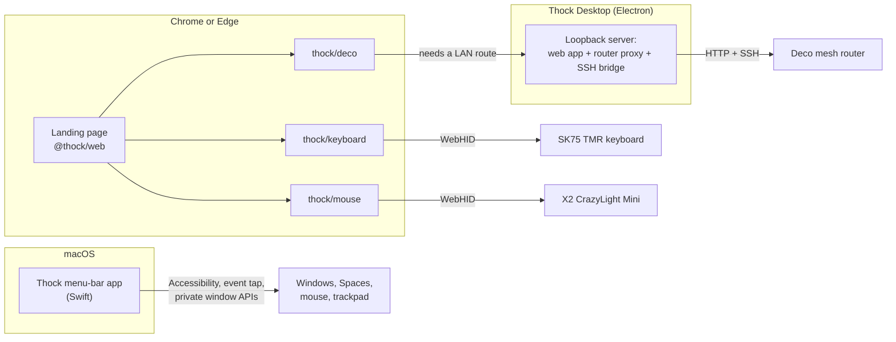
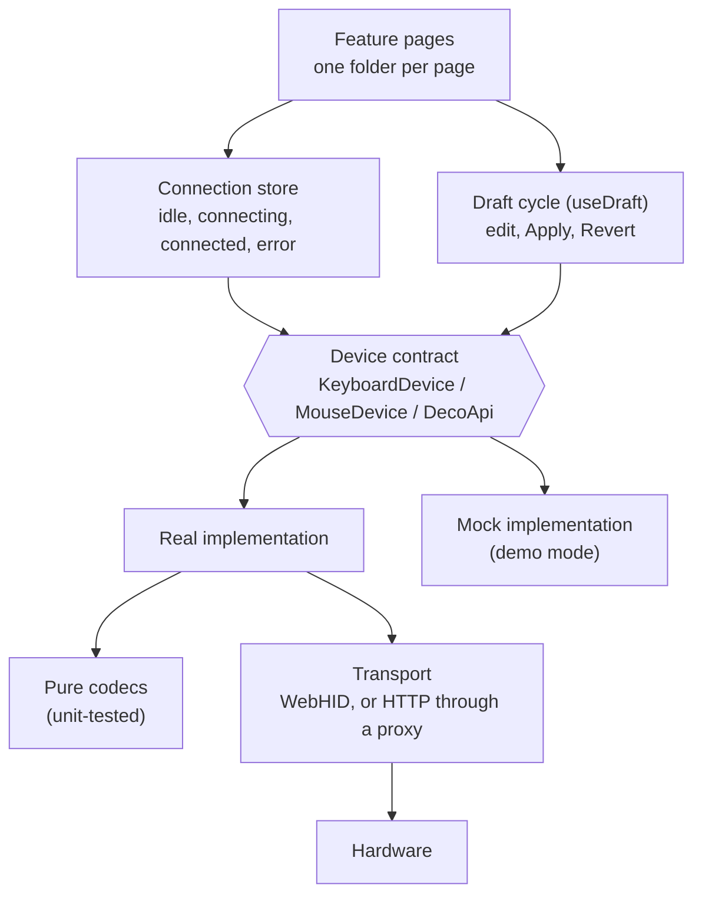
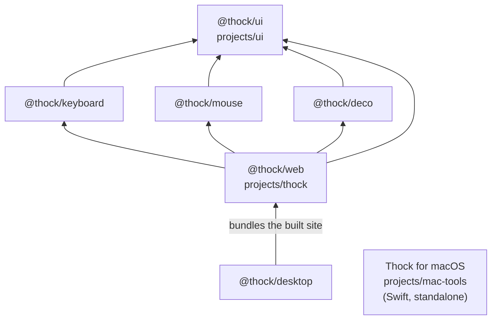
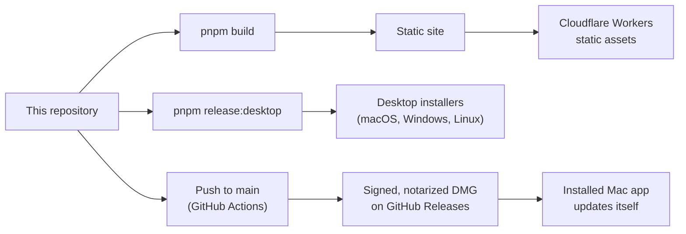

# thock

thock is a set of local-first tools for input devices and a home network: a macOS menu-bar app,
browser configurators for a keyboard and a mouse, a manager for a mesh router, and a desktop app
that wraps the web tools. Every tool talks straight to the hardware or to the operating system.
There are no vendor drivers, no accounts and no cloud service.

## Projects

| Project | What it is | Feature guide |
|---------|-----------|---------------|
| [`projects/mac-tools`](projects/mac-tools) | **Thock for macOS.** A menu-bar window switcher with browser tabs, window groups, instant Space switching, mouse tweaks and chassis taps (Swift). | [docs/mac-tools.md](docs/mac-tools.md) |
| [`projects/keyboard`](projects/keyboard) | **thock/keyboard.** A WebHID configurator for the Womier SK75 TMR Hall-effect keyboard. | [docs/keyboard.md](docs/keyboard.md) |
| [`projects/mouse`](projects/mouse) | **thock/mouse.** A WebHID configurator for the Pulsar X2 CrazyLight Mini. | [docs/mouse.md](docs/mouse.md) |
| [`projects/deco`](projects/deco) | **thock/deco.** A manager for a TP-Link Deco mesh router over its local API. | [docs/deco.md](docs/deco.md) |
| [`projects/thock`](projects/thock) | **The landing page and host app** (`@thock/web`). Picks a device and loads its configurator. | [docs/web.md](docs/web.md) |
| [`projects/desktop`](projects/desktop) | **Thock Desktop.** An Electron app that gives the web tools a route to the router. | [docs/desktop.md](docs/desktop.md) |
| [`projects/ui`](projects/ui) | **The shared design system** (`@thock/ui`): theme, components, page shell, state hooks. | [docs/ui.md](docs/ui.md) |

## Overall design

### What runs where



The Mac app is separate from the rest: it is native Swift and shares only the name and the coding
style. The other six projects are one web codebase. The keyboard and mouse tools run in any
Chromium browser straight from the deployed site. The router tool needs a route to the LAN, which
the dev server or the desktop app provides.

### Principles

1. **Local only.** Each tool talks to the device over USB (WebHID), to the router on the LAN, or
   to macOS itself. Nothing is sent anywhere else.
2. **Protocol code is pure and tested.** Each device has a layer of plain TypeScript codecs with
   no UI in it, and the unit tests target that layer.
3. **A device is a contract.** Pages talk to a typed interface (`KeyboardDevice`, `MouseDevice`,
   `DecoApi`), never to the transport. A simulated device implements the same contract, so every
   tool has a full demo mode that needs no hardware.
4. **The user decides when to write.** Reading is free. A write happens only from a user action:
   pages with several related settings keep a draft and send it on **Apply**, and nothing is
   written on load or on a timer.
5. **One look, one shell.** All web tools use the same theme, page frame and edit cycle from
   `@thock/ui`.
6. **Honest about verification.** The device protocols were reverse-engineered. Anything not yet
   confirmed on real hardware is marked, in the protocol references and in the tools themselves.
7. **Small code.** The code is deliberately minimal. A `ponytail:` comment marks a deliberate
   shortcut and names its limit and the way to upgrade it.

### The pattern every device tool follows



Each tool exports one React component that takes `mode` (`connect` or `demo`) and `onExit`. The
landing page loads the chosen tool on demand and passes those two props.

### How the packages depend on each other



Only `@thock/web` has a real build. The device packages and the design system are compiled into
it from source.

### How each part is delivered



## Getting started

The web projects are a pnpm workspace. Use Chrome or Edge.

```bash
pnpm install
pnpm dev              # landing page at http://localhost:5173
pnpm dev:keyboard     # demo keyboard, no hardware needed
pnpm dev:mouse        # demo mouse
pnpm dev:deco         # demo router
pnpm dev:desktop      # the desktop app, with hot reload
```

```bash
pnpm test             # unit tests in every package (vitest)
pnpm lint             # oxlint
pnpm typecheck        # tsc
pnpm build            # build the site to projects/thock/dist
pnpm release          # build, then deploy with wrangler
pnpm release:desktop  # build, then package the desktop app
```

The Mac app is built separately: open `projects/mac-tools/thock.xcodeproj` in Xcode. See
[docs/mac-tools.md](docs/mac-tools.md#build-test-release-update).

## Repository layout

```text
projects/
  mac-tools/   Thock for macOS (Swift, Xcode project)
  keyboard/    thock/keyboard
  mouse/       thock/mouse
  deco/        thock/deco
  thock/       landing page and host app (@thock/web)
  desktop/     Thock Desktop (Electron)
  ui/          shared design system (@thock/ui)
docs/
  *.md             one feature guide per project (linked above)
  deco-protocol/   the router's HTTP and TMP protocols, firmware notes, a reference bridge
  marathon-redesign/  the design system's specification
.github/workflows/thock-mac.yml   release pipeline for the Mac app
wrangler.jsonc                    Cloudflare deployment of the site
```

## More documentation

- **Protocol references:** [keyboard](projects/keyboard/PROTOCOL.md),
  [mouse](projects/mouse/PROTOCOL.md), [router](docs/deco-protocol/README.md)
- **Design system specification:** [docs/marathon-redesign](docs/marathon-redesign/README.md)
- **Desktop app design:** [docs/desktop-electron-plan.md](docs/desktop-electron-plan.md)
- **Mac app notes:** [mouse tweaks](projects/mac-tools/MOUSE.md),
  [window groups](projects/mac-tools/WINDOW_GROUPS.md)
- **Notes for contributors and coding agents:** the `CLAUDE.md` file in the repository root and in
  each project
