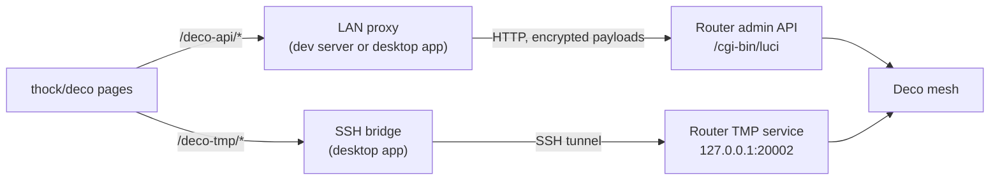
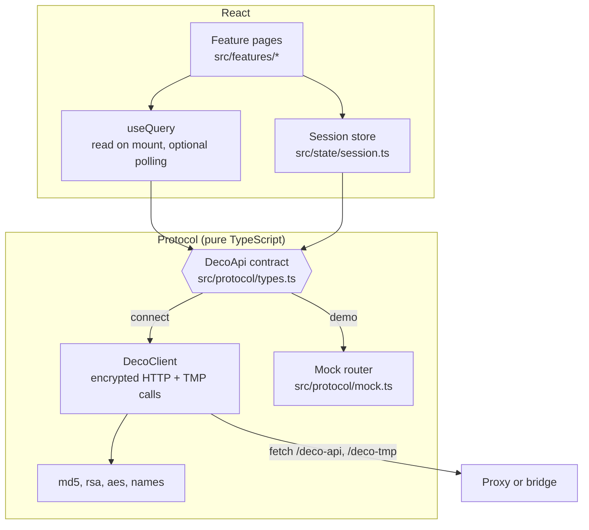
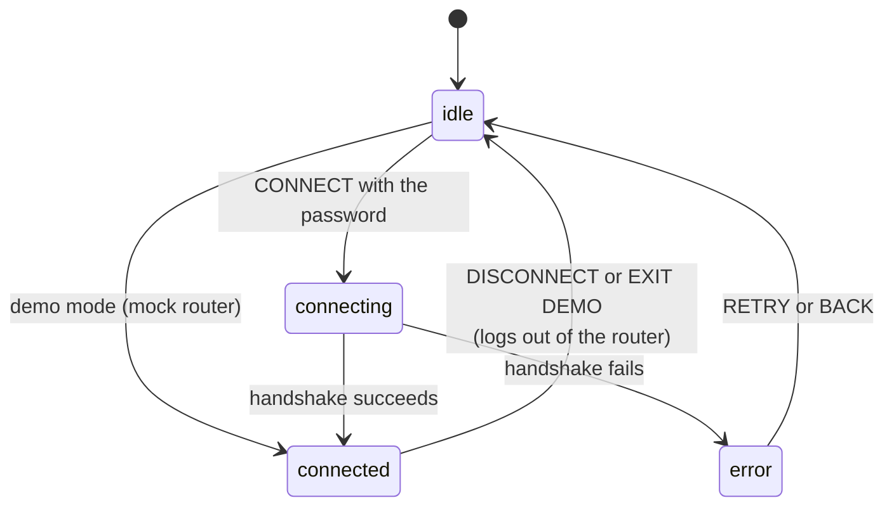
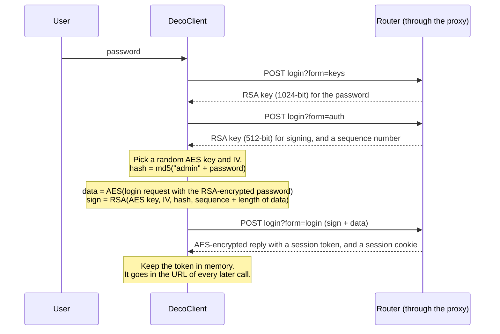
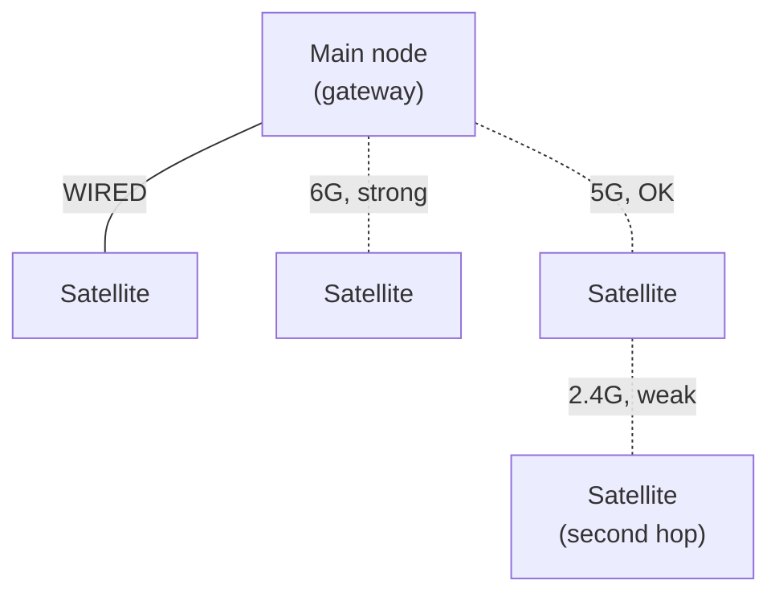
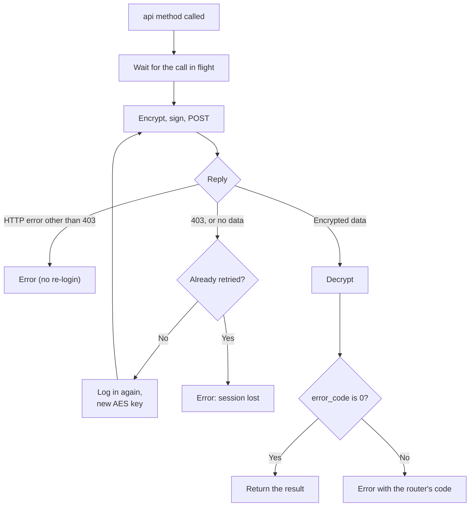

# thock/deco (`projects/deco`, `@thock/deco`)

thock/deco is a manager for a TP-Link Deco mesh router. It talks to the router's own local admin
API on the LAN. It does not use WebHID and it does not use the TP-Link cloud. It shows the mesh,
its nodes and clients, and changes Wi-Fi, internet, LAN and system settings.

- Source: [`projects/deco/src/`](../projects/deco/src)
- Protocol reference: [`docs/deco-protocol/`](deco-protocol/README.md)
- Mounted by the [landing page](web.md); built on the [shared design system](ui.md)
- Hardware: built and tested against a Deco XE75 Pro (hardware 2.0, firmware 1.2.14) with five
  nodes. No other model is recorded as tested.

Back to the [project overview](../README.md).

> **Verification status.** Login and the read calls were checked on the real router. Many write
> calls are marked unverified in the code, and the app says so on the affected cards. The
> SSH-only "Advanced" pages have never been run against hardware. See
> [What is verified](#what-is-verified).

## Contents

- [Running it](#running-it)
- [Where it can run](#where-it-can-run)
- [Architecture](#architecture)
- [Login and session](#login-and-session)
- [Pages](#pages)
- [How settings are written](#how-settings-are-written)
- [Protocol](#protocol)
- [What is verified](#what-is-verified)
- [Safety rules](#safety-rules)
- [Tests](#tests)
- [File map](#file-map)

## Running it

```bash
pnpm dev:deco                # from the repository root: opens the demo router at /?mock=deco
pnpm dev                     # then pick UNIT 03, press CONNECT and enter the owner password
DECO_HOST=10.0.0.1 pnpm dev  # use a router at another address (default 192.168.68.1)
```

From `projects/deco`: `pnpm test` (vitest), `pnpm lint` and `pnpm typecheck`.

Demo mode uses a simulated five-node XE75 Pro mesh with 14 clients, three Wi-Fi bands and sample
data for every page, including the Advanced pages.

## Where it can run

A browser page cannot call the router directly, because the router's API sends no CORS headers.
Something on the LAN has to forward the calls. The router also has two channels: an HTTP API, and
a second protocol (TMP) that is reachable only through SSH and carries the settings the HTTP API
does not expose.



| Where the page runs | Real router | Advanced (SSH) pages |
|---------------------|-------------|----------------------|
| Deployed static site | No. CONNECT is disabled. Demo works. | Shown in demo only |
| Vite dev server (`pnpm dev`) | Yes, through the `/deco-api` dev proxy | Hidden (shown with `?ssh`, but nothing answers them without a separately run bridge) |
| [Desktop app](desktop.md) | Yes, through its built-in proxy | Shown. See the desktop doc for their current state. |

The app decides this from `window.thock.capabilities` when the desktop app provides it, and from
the dev-server flag otherwise.

## Architecture

The package exports one component, `DecoApp({ mode, onExit })`.



The real client and the mock implement the same `DecoApi` contract, so demo mode runs the same
pages as a real router.

## Login and session

The login screen asks for one thing: the owner's TP-Link ID password (the one used in the Deco
phone app). The router allows one owner session at a time, so **logging in here signs the Deco
phone app out**. The login screen says so.



The password is never sent in clear text. The handshake uses two RSA keys from the router and an
AES key chosen by the client.



Login errors are translated: a wrong password, another active owner session, and no answer from
the router each get their own message.

The password is held in memory by the client for as long as the session lasts, so that it can log
in again if the router drops the session. It is never written to storage or logged, and a page
reload starts again at the login screen.

## Pages

The top bar has three tabs: NETWORK, SETTINGS and HELP. The left list groups the pages.

| Group | Page | What it shows or controls | Channel |
|-------|------|---------------------------|---------|
| Network | Overview | Internet status, router load, mesh summary, client counts | HTTP |
| Network | Nodes | Each mesh node, its backhaul signal, and reboot | HTTP |
| Network | Map | A diagram of the mesh and its links | HTTP |
| Network | Clients | Online clients, speeds, priority, rename, block | HTTP |
| Configuration | Wi-Fi | Per-band networks, guest and IoT networks, radio options | HTTP |
| Configuration | Internet | WAN status and settings, MAC clone, WAN mode, speed test | HTTP |
| Configuration | LAN | LAN address, DHCP reservations, VLAN | HTTP |
| Advanced | DHCP | The DHCP server's address pool | SSH |
| Advanced | Forwarding | Port forwarding, DMZ, UPnP, NAT pass-through | SSH |
| Advanced | DDNS | Dynamic DNS | SSH |
| Advanced | QoS | Bandwidth limits | SSH |
| Advanced | Firewall | IPv6 firewall rules | SSH |
| Advanced | VPN | VPN server status (read-only) | SSH |
| Settings | General | Status LED, time, reboot all nodes | HTTP |
| Help | Help | How the app connects and what each page does | — |

### Overview

Read-only, refreshed every 10 seconds.

- **Internet:** status, connection type, WAN IP, gateway, DNS, LAN IP.
- **Load:** CPU and memory meters (red at 80 % or more).
- **Mesh:** nodes connected, the main node's model and firmware.
- **Clients:** online total, and counts for wired, 2.4 GHz, 5 GHz and 6 GHz.

### Nodes

One card per node, main node first: name, model, IP, firmware, MAC, status and the backhaul signal
on each band. **Reboot** restarts one node after a confirmation.

### Map

A tree diagram of the mesh, with the main node at the top and one row per hop.



Solid lines are wired links. Dashed lines are wireless and are labelled with the band in use. The
line colour shows signal strength: strong, OK or weak. Clicking a node shows its details.

### Clients

A table of online clients, refreshed every 5 seconds: name, IP, MAC, link type, signal, download
and upload speed. It has a band filter and a search box (name, IP or MAC).

| Action | Effect |
|--------|--------|
| Priority switch | Gives the client priority, at once |
| Rename | Sets the client's name |
| Block | Removes the client's network access, after a confirmation |
| Unblock | In the **Blocked** card |

### Wi-Fi

The page uses a draft with **Apply** and **Revert**. Only the fields that changed are sent.

- **Per band** (2.4 GHz, 5 GHz, a second 5 GHz band if present, 6 GHz): on/off, network name and
  password for the main network and for the guest network. Under *Advanced*: hide the network
  name, channel, channel width and mode.
- **IoT network:** on/off, name, password, and which bands carry it.
- **Advanced radio** (applies at once): fast roaming (802.11r), beamforming, 160 MHz channels.

Changing a name or password briefly disconnects every client. The page refuses to apply a change
that would turn off the main network on every band.

### Internet

- **Status:** IPv4, dial status, connection type, IPv6 and link, with **Connect** and
  **Disconnect** (disconnect asks first).
- **Connection:** dial type (dynamic IP, static IP or PPPoE) and its fields, and custom DNS
  servers. Uses Apply / Revert.
- **MAC clone:** on/off and the MAC address to present.
- **WAN mode:** a free-text mode. Only `normal` is verified.
- **Speed test:** runs the router's own test and shows download, upload and latency.

### LAN

- **LAN IP:** change the router's address and mask. This disconnects every device and the app, so
  it asks first.
- **DHCP reservations:** fix an IP address to a device's MAC. Add from the list of connected
  clients or by hand.
- **VLAN:** on/off, with a confirmation.

### Advanced pages

These settings are not available over the router's HTTP API. They go through the SSH bridge.

| Page | Controls |
|------|----------|
| DHCP | Start and end address, gateway, lease time, DNS servers |
| Forwarding | Port-forwarding rules (add, remove); DMZ host; UPnP; SIP ALG and PPTP, L2TP, IPSec pass-through |
| DDNS | Provider (TP-Link, No-IP, DynDNS), domain, account, update interval |
| QoS | On/off, automatic or custom bandwidth (Mbps down and up) |
| Firewall | IPv6 rules: name, address, port, protocol (add, remove) |
| VPN | Whether OpenVPN, WireGuard, PPTP and L2TP servers are on (read-only) |

### Settings → General

- **LED:** the status light on every node, with a night mode and its start and end times.
- **Time:** current time, timezone and daylight saving.
- **Power:** reboot every node, after a confirmation.

## How settings are written

Every write comes from a user action. Nothing is written on load, on a timer or as a side effect
of a read. Polling only reads.

- **Draft pages** (Wi-Fi, and the Internet connection card) use the shared
  [draft cycle](ui.md#the-draft-cycle): edit, then **Apply** or **Revert**.
- **Single controls** (switches, rename, block and similar) write at once and show a toast.
- **Risky actions** ask first: rebooting, blocking a client, disconnecting the internet, changing
  the LAN IP, MAC clone, WAN mode, VLAN, enabling DMZ, and removing a reservation or rule.

After a write the page reads the affected data again.

## Protocol

### HTTP API

Every call is a `POST` to `/cgi-bin/luci/;stok=<token>/<controller>?form=<form>`. The JSON payload
`{operation, params}` is AES-encrypted and signed with RSA, exactly as in the login handshake. The
reply is AES-encrypted JSON.

Calls are sent one at a time. If the router has dropped the session, the client logs in again and
repeats the call once.



Names that can hold any text (network names, Wi-Fi passwords, client and node names) travel as
base64 and are decoded for display.

### TMP over SSH

TMP is the binary protocol the Deco phone app uses. It listens only on the router itself
(`127.0.0.1:20002`), so it is reached through an SSH tunnel. The web client does not speak it. It
sends plain JSON to `/deco-tmp/<route>`, and the bridge in the [desktop app](desktop.md) turns that
into TMP frames. Without a bridge, an Advanced page reports that it needs the desktop app.

The full references are in [`docs/deco-protocol/`](deco-protocol/README.md): the HTTP handshake and
forms, the list of HTTP endpoints, the TMP opcode catalogue and the firmware notes.

## What is verified

| Area | Status |
|------|--------|
| Login, logout, and the read calls behind Overview, Nodes, Map, Clients, Wi-Fi, Internet, LAN and time | Checked on the real router |
| Wi-Fi changes, reboot, unblock, rename, priority | Implemented; no recorded test on hardware |
| LED on/off, block, WAN settings and actions, WAN mode, LAN IP, MAC clone, VLAN, reservations, radio options, time, speed test | Marked unverified in the code and in the app |
| Everything on the Advanced pages (TMP) | Derived from the Deco phone app's code; never run against hardware |

## Safety rules

- **The password is used in memory only.** It is not stored and not logged.
- **One call at a time,** and at most one automatic re-login per call, because every login ends
  any other owner session.
- **Confirmation before risky actions,** as listed above.
- **Input checks:** IPv4 addresses, MAC addresses, port numbers 1–65535 and required names are
  checked before a write.
- **Changing the owner password is not implemented,** on purpose. VPN is read-only.
- **Unexpected replies do not crash a page.** A list with a strange shape is treated as empty.

## Tests

`pnpm test` runs 10 vitest files: the MD5, RSA, AES and name codecs (checked against Node's own
crypto); the client against a fake router that uses real encryption (login, wrong password,
re-login, one call in flight, request shapes); the mock router; and the pure helpers for client
formatting, the Wi-Fi patch, the map layout and LAN input checks. There are no page tests and no
tests of the TMP calls.

## File map

| Path (under `projects/deco/src`) | Holds |
|------|-------|
| `index.tsx` | `DecoApp`: tabs, page list, login gate, the Enter key |
| `state/session.ts`, `nav.ts`, `capabilities.ts` | Session store, page navigation, what the host can reach |
| `protocol/types.ts` | The `DecoApi` contract and data types |
| `protocol/client.ts` | The real client: handshake, encrypted calls, TMP calls |
| `protocol/md5.ts`, `rsa.ts`, `aes.ts`, `names.ts` | Codecs |
| `protocol/mock.ts` | The simulated router |
| `lib/useQuery.ts` | The read hook used by every page |
| `components/parts.tsx` | Small shared parts: rows, error line, signal bars, confirm dialog |
| `features/<page>/` | One folder per page, with its pure helpers and their tests |
