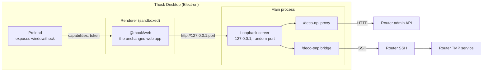
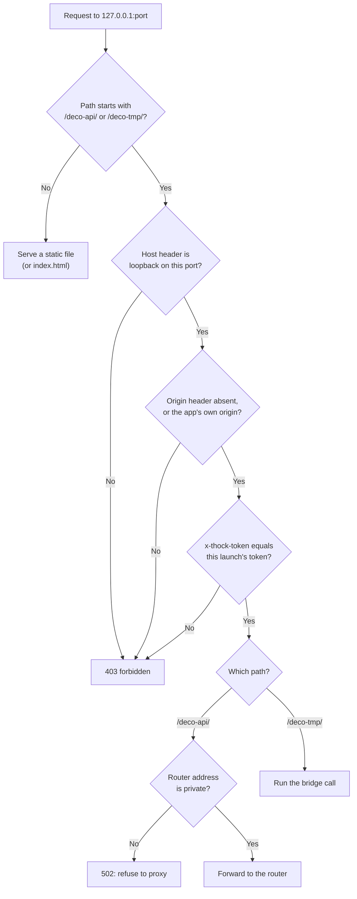
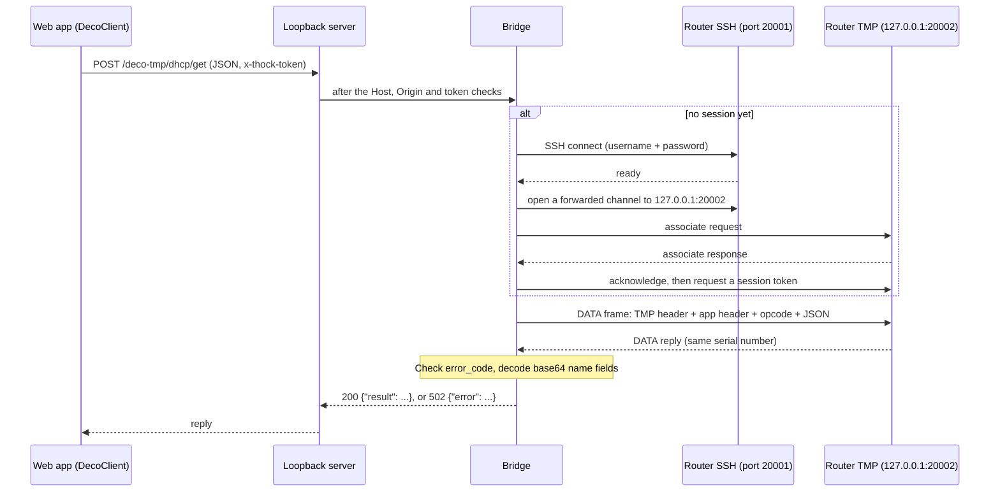
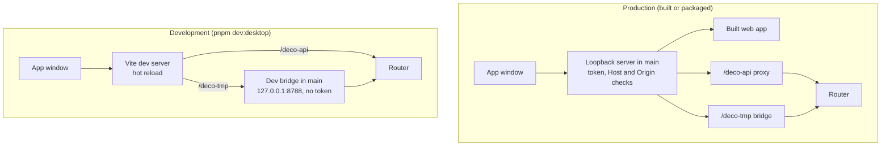

# Thock Desktop (`projects/desktop`, `@thock/desktop`)

Thock Desktop is an Electron app that wraps the web app. It exists for one reason: a web page
cannot reach a router on the LAN, and a desktop app can. The app serves the same
[landing page and configurators](web.md) from a server on the local machine, and adds two things
the browser cannot do:

1. an HTTP proxy to the router's admin API, and
2. a bridge that carries the router's SSH-only settings.

- Source: [`projects/desktop/src/`](../projects/desktop/src)
- Design document: [`docs/desktop-electron-plan.md`](desktop-electron-plan.md)
- Router side: [thock/deco](deco.md) and [`docs/deco-protocol/`](deco-protocol/README.md)

Back to the [project overview](../README.md).

> **Current state.** The app, proxy and bridge are implemented. Two things are not finished:
>
> - **The SSH bridge has never been run against a real router.** Its TMP framing comes from the
>   Deco phone app's code and is covered by unit tests only.
> - **No screen submits the SSH credentials.** The bridge needs a username and password, and the
>   app exposes a function to pass them in, but no page calls it. Until one does, every Advanced
>   page in thock/deco answers "SSH credentials not set".
>
> The HTTP features (Overview, Nodes, Map, Clients, Wi-Fi, Internet, LAN, Settings) do not depend
> on either point.

## Contents

- [Running it](#running-it)
- [Process model](#process-model)
- [The local server](#the-local-server)
- [Security checks](#security-checks)
- [The SSH bridge](#the-ssh-bridge)
- [Credentials](#credentials)
- [Development and production wiring](#development-and-production-wiring)
- [Packaging](#packaging)
- [Tests](#tests)
- [File map](#file-map)

## Running it

```bash
pnpm dev:desktop                         # from the repository root: app with hot reload
DECO_HOST=192.168.1.1 pnpm dev:desktop   # use a router at another address
pnpm --filter @thock/desktop build       # build the web app, then bundle main and preload
pnpm --filter @thock/desktop start       # run the built app on its loopback server
pnpm release:desktop                     # build, then package installers
```

| Variable | Default | Meaning |
|----------|---------|---------|
| `DECO_HOST` | `192.168.68.1` | Router address for the proxy and for SSH |
| `DECO_SSH_PORT` | `20001` | Router SSH port (port 22 is filtered on the XE75 Pro) |
| `BRIDGE_DEV_PORT` | `8788` | Port of the development-only bridge |

To check that a router accepts SSH: `nmap -Pn -p 22,20001 <router-ip>`. If neither port is open,
the bridge cannot connect and only the HTTP features work.

## Process model



- **Main** owns the window, the loopback server, the SSH session and the credentials.
- **Preload** exposes two small objects to the page and nothing else: `window.thock` (what this
  host can do) and `window.thockDesktop` (one function to submit credentials).
- **Renderer** is the web app, unchanged. It runs with context isolation on, Node integration off
  and the sandbox on. Navigation to another origin is blocked, and external links open in the
  system browser.

`window.thock` tells the web app that both router channels are available:

```ts
window.thock = {
  desktop: true,
  capabilities: { http: true, ssh: true },
  routerHost,   // from DECO_HOST
  token,        // random, new on every launch
}
```

## The local server

The main process starts one HTTP server bound to `127.0.0.1` on a random free port. The window
loads the app from it.

| Path | Handled by | Does |
|------|-----------|------|
| `/deco-api/*` | Proxy | Forwards the request to the router over HTTP. It rewrites the router's session cookie so that the app's origin keeps it. |
| `/deco-tmp/*` | Bridge | Turns a JSON request into a TMP call over SSH. |
| anything else | Static files | Serves the built web app, falling back to `index.html`. |

## Security checks

The two router paths are powerful, so every request to them must pass three checks. Static files
are served without them.



| Measure | Why |
|---------|-----|
| Bound to `127.0.0.1` only | Nothing else on the LAN can reach the server |
| Random token per launch | A page in the user's normal browser cannot drive the bridge, even if it finds the port |
| Host and Origin checks | Stops DNS-rebinding attacks from other sites |
| Private-address check on the proxy target | The proxy can never be pointed at a public address. The router address is fixed at launch and never taken from a request. |
| Locked-down renderer | The page has no Node access and only the two small objects from the preload |

Not in place yet: the private-address check is applied to the proxy but not to the SSH target (both
use the same `DECO_HOST`), the server sets no Content-Security-Policy header, and the SSH host key
is not verified.

## The SSH bridge

The router's phone-app protocol (TMP) listens only on the router itself. The bridge opens one SSH
session, forwards a channel to that port and keeps it for later calls.



Each route maps to one TMP opcode. The bridge also converts fields that the router stores as base64
(service names, rule names, DDNS account) so that the web app sends and receives plain text.

| Routes | Feature |
|--------|---------|
| `dhcp/get`, `dhcp/set` | DHCP server |
| `port-forwarding/get`, `add`, `remove` | Port forwarding |
| `dmz/get`, `dmz/set` | DMZ |
| `upnp/get`, `upnp/set` | UPnP |
| `sip-alg/get`, `sip-alg/set` | NAT pass-through |
| `ddns/get`, `ddns/set` | Dynamic DNS |
| `qos/get`, `qos/set` | QoS |
| `ipv6-firewall/get`, `add`, `remove` | IPv6 firewall |
| `vpn/get` | VPN server status |
| `raw` | Any opcode, for exploration |

Timeouts: 30 seconds to connect, 10 seconds to associate, 30 seconds per call. If the SSH session
closes, the next request opens a new one. A request body larger than one TMP fragment is refused.

## Credentials

The bridge needs the router's SSH username and password.

- The page passes them to the main process with `window.thockDesktop.submitCredentials(username,
  password, remember)`. They are kept in memory.
- With `remember`, they are also encrypted with the operating system's keychain (Electron
  `safeStorage`) and saved in the app's data folder. They are loaded at the next launch.
- They are never written or logged in clear text.

As noted at the top, no page calls this function yet, and there is no way to forget saved
credentials from the app.

## Development and production wiring



In development the renderer is served by Vite with hot reload, and the main and preload scripts
rebuild and relaunch on save. Production uses the single loopback server for everything.

## Packaging

`pnpm release:desktop` builds the web app, bundles the main and preload scripts and runs
electron-builder.

| Platform | Output |
|----------|--------|
| macOS | DMG (Apple silicon and Intel) |
| Windows | NSIS installer (x64) |
| Linux | AppImage (x64) |

The built web app is copied into the package as a resource. Icons, code signing and auto-update are
not set up.

## Tests

`pnpm test` in `projects/desktop` runs two vitest files: the private-address check, and the TMP
codec (frame headers, checksums, reassembly, and the oversize-body refusal). The server, proxy,
bridge session and preload have no tests.

## File map

| Path (under `projects/desktop`) | Holds |
|------|-------|
| `src/main/index.ts` | App lifecycle, window, token, credentials, dev or production start-up |
| `src/main/server.ts` | The loopback server: routing, checks, static files |
| `src/main/security.ts` | Host, Origin and token checks; the private-address test |
| `src/main/proxy.ts` | The `/deco-api` proxy |
| `src/main/bridge.ts` | The `/deco-tmp` routes and the shared SSH session |
| `src/main/tmp.ts` | The TMP codec and session |
| `src/main/secrets.ts` | Keychain encryption for saved credentials |
| `src/preload/index.ts` | `window.thock` and `window.thockDesktop` |
| `electron.vite.config.ts` | Development build and dev proxies |
| `electron-builder.yml` | Packaging targets |
