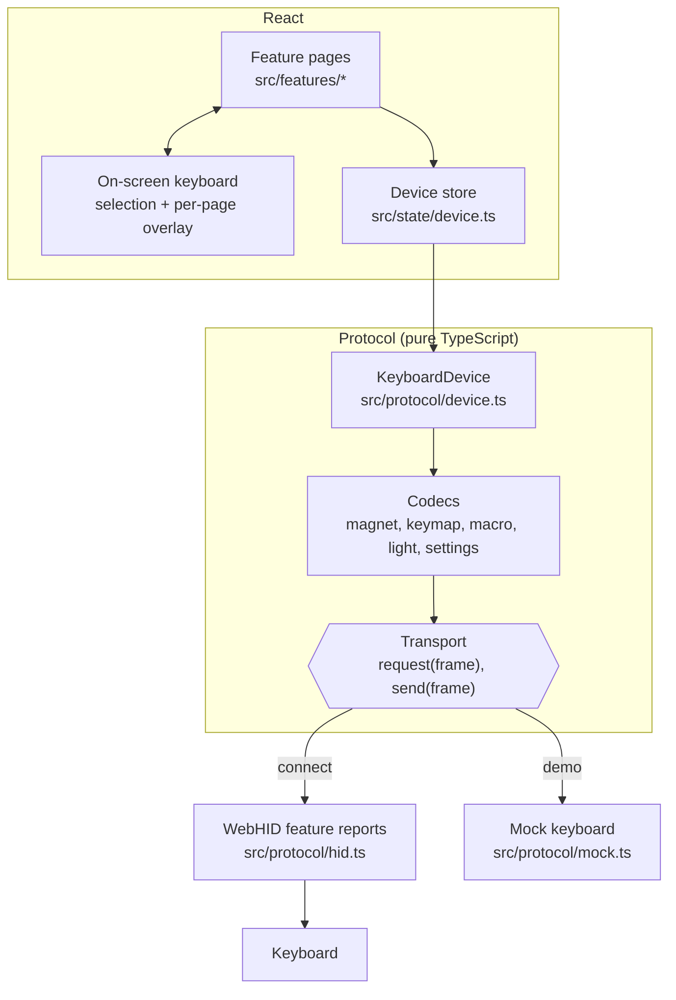
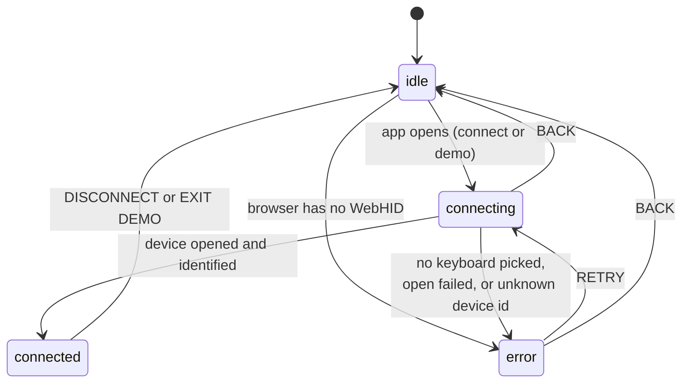
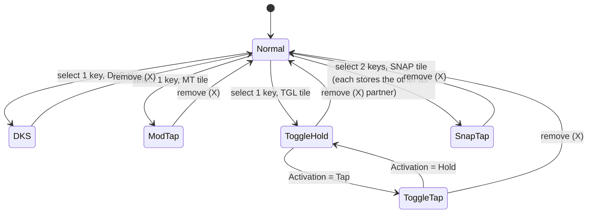
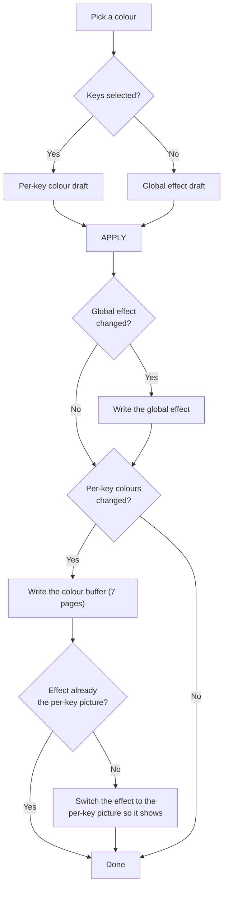
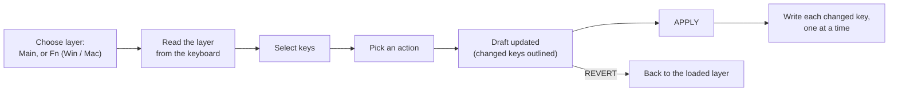
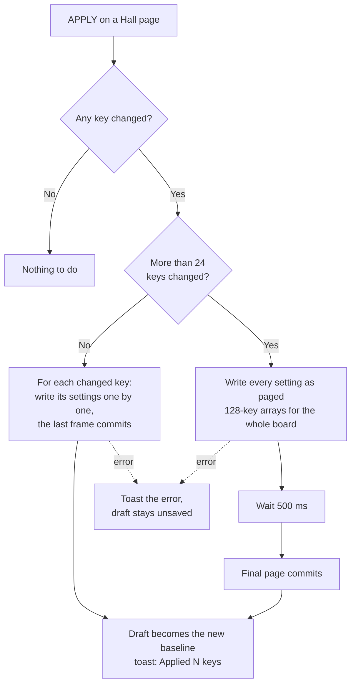
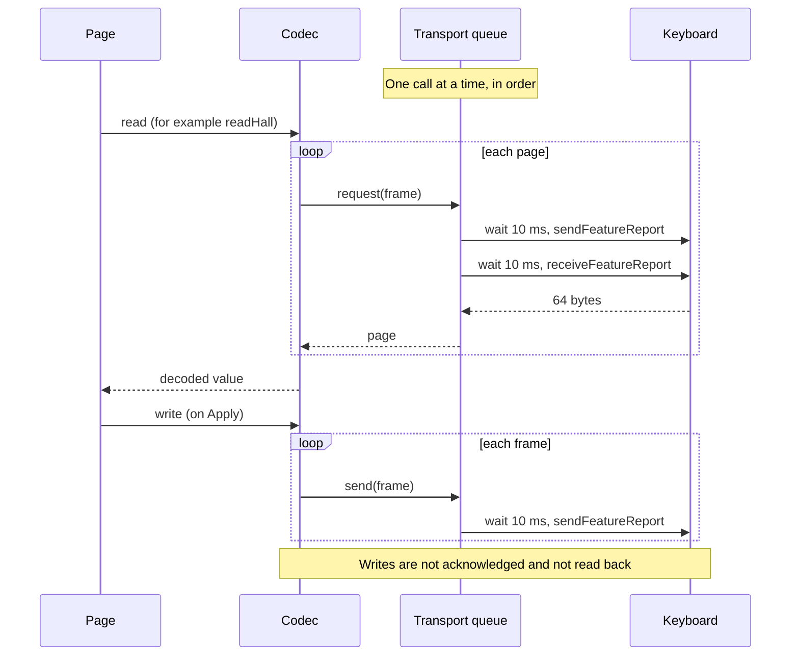

# thock/keyboard (`projects/keyboard`, `@thock/keyboard`)

thock/keyboard is a browser configurator for the Womier SK75 TMR, a Hall-effect keyboard. It talks
to the board over WebHID, so nothing is installed and nothing leaves the machine. It covers
per-key actuation, Rapid Trigger, advanced key modes, key remapping on two layers, macros, RGB
lighting and board settings.

- Source: [`projects/keyboard/src/`](../projects/keyboard/src)
- Protocol reference: [`projects/keyboard/PROTOCOL.md`](../projects/keyboard/PROTOCOL.md)
- Mounted by the [landing page](web.md); built on the [shared design system](ui.md)
- Browsers: Chrome or Edge on macOS or Windows. Firefox and Safari have no WebHID.
- Models: SK75 TMR (US) and SK75 TMR (EU), 81 keys each. Any other board is refused at connect.

Back to the [project overview](../README.md).

> **Not yet checked on hardware.** The app was built against a reverse-engineered protocol and a
> software mock. Ranges, units and defaults marked ⚠ in `PROTOCOL.md` are not confirmed on a real
> board. The app's Help page says the same.

## Contents

- [Running it](#running-it)
- [Architecture](#architecture)
- [Connecting](#connecting)
- [Selecting keys](#selecting-keys)
- [Pages](#pages)
- [How settings are written](#how-settings-are-written)
- [Protocol](#protocol)
- [Safety rules](#safety-rules)
- [Known limits](#known-limits)
- [Tests](#tests)
- [File map](#file-map)

## Running it

```bash
pnpm dev:keyboard  # from the repository root: opens the demo keyboard at /?mock=keyboard
pnpm dev           # then pick UNIT 01 and press CONNECT for a real keyboard
```

From `projects/keyboard`: `pnpm test` (vitest) and `pnpm typecheck`.

Demo mode uses a simulated US board with firmware 1300. Every key starts at 2.0 mm actuation with
Rapid Trigger off, and lighting starts as a steady teal.

## Architecture

The package exports one component, `KeyboardApp({ mode, onExit })`. The protocol layer is plain
TypeScript with no React in it.



The real transport and the mock implement the same `Transport` interface, so demo mode runs the
same device code, codecs and pages as a real board.

## Connecting



Identification is two requests. The first returns the device id (which selects the US or EU key
matrix) and the firmware version. The second returns the travel precision, which sets how fine the
travel sliders are (0.005 mm on current firmware). Firmware 1024 or later also supports a top dead
zone. After that the app reads the active profile.

## Selecting keys

Six pages work on a selection of keys on the on-screen keyboard.

| Action | Result |
|--------|--------|
| Click a key | Select only that key |
| Shift, ⌘ or Ctrl + click | Add the key to, or remove it from, the selection |
| ⌘A or Ctrl+A, or **Select all** | Select all 81 keys |
| Esc, or **Discard** | Clear the selection |

The selection is cleared when you open another page. A control shows the value of the first
selected key. With nothing selected it shows the most common value on the board, and the editing
controls are disabled. All Hall-effect settings are per key, so a board-wide change is made by
selecting every key.

Each page also paints the keyboard with what it edits: actuation depth as a bar on each key, Rapid
Trigger keys in cobalt, advanced-mode keys in purple with the mode name, per-key colours as the key
background, and remapped keys with their new label.

## Pages

The top bar has three tabs (KEYBOARD, SETTINGS, HELP), the model and firmware version, and profile
chips `1`–`4`.

| # | Page | What it controls | Writes |
|---|------|------------------|--------|
| 1 | Quick Settings | Actuation point, Rapid Trigger and switch type | Apply / Revert |
| 2 | Actuation Point | Actuation point, release travel, dead zones, live travel readout | Apply / Revert |
| 3 | Rapid Trigger | Rapid Trigger on/off and sensitivity | Apply / Revert |
| 4 | RGB Settings | Global effect, and per-key colours | Apply / Revert |
| 5 | Remap | What each key sends, on the Main and Fn layers; macros | Apply / Revert |
| 6 | Advanced Keys | Snap Tap, Dynamic Keystroke, Mod Tap, Toggle | Apply / Revert |
| — | Settings → General | Report rate, debounce, sleep timers, keyboard options | Immediately |
| — | Help | Notes on browser support and the unverified protocol | — |

### Hall-effect settings (pages 1, 2, 3 and 6)

A Hall-effect switch reports how far the key is pressed, so each key can have its own trigger
points. The four Hall pages edit one record per key.

| Setting | Range | Page |
|---------|-------|------|
| Actuation point | 0.1–3.4 mm | Quick Settings, Actuation Point |
| Release travel | 0.1–3.4 mm | Actuation Point |
| Dead zone (bottom) | 0–1 mm | Actuation Point |
| Dead zone (top) | 0–1 mm (firmware 1024 or later) | Actuation Point |
| Rapid Trigger | On / off | Quick Settings, Rapid Trigger |
| Rapid Trigger press and lift sensitivity | 0.005–2.5 mm | Quick Settings, Rapid Trigger |
| Switch type | Six magnetic switch types | Quick Settings |
| Key mode and its parameters | See Advanced Keys | Advanced Keys |

Notes:

- **Split sensitivity.** Rapid Trigger has one sensitivity slider by default, which sets press and
  lift together. Turning on *Split sensitivity* gives one slider for each.
- **Live travel.** On the Actuation Point page, *Live travel* polls the board ten times a second
  and shows how far each key is pressed right now. It only reads.

### Advanced Keys

A key is in one mode at a time. Select the key (two keys for Snap Tap) and click a mode tile.



| Mode | What the app says it does | Parameters |
|------|---------------------------|------------|
| Snap Tap (SOCD) | Two keys race each other; the one pressed further wins and cancels the other | The partner key |
| Dynamic Keystroke (DKS) | Fires different actions at different points of one key's travel | Start travel (0.1–3.4 mm) and four trigger bytes (0–255) |
| Mod Tap | A quick tap sends one action; holding past a threshold sends another | Hold time (0–2550 ms) |
| Toggle Key | The key latches on until pressed again | Activation: Hold or Tap |

The **Active Advanced Keys** card lists every key that is not in normal mode, with a button to
return it to normal. Rapid Trigger is a separate switch and can be combined with any mode.

### RGB Settings

The page has two drafts: the global effect, and a colour per key.

- **Colours:** a colour picker, RGB inputs and seven preset swatches. With keys selected, the
  colour paints those keys. With nothing selected, it sets the global effect colour.
- **Effects:** brightness (0–4), speed (0–4), a *Dazzle* switch, and 21 effect tiles (Always On,
  Breath, Neon, Wave, Ripple, Raindrop, Snake and others).



Per-key colours are stored per profile. The global effect is not.

### Remap

Remap changes what a key sends. There are two layers: **Main**, and **Fn** (with separate Windows
and macOS variants).



Ways to pick an action:

| Source | Actions |
|--------|---------|
| Basic Characters | Letters, digits and common punctuation |
| Extended Characters | The rest of the HID keyboard page |
| Modifiers | Pick Ctrl, Shift, Alt or Win, then a basic character, to make a combination |
| Functions | Fn, Disabled, Cycle light effect |
| Profiles | Switch to profile 1–4 |
| Media and Audio control | Brightness, track, play/pause, mute, volume, email, browser home |
| Macros | Macro 0–15 (also opens the macro editor) |
| **Press a key…** | Press a physical key to assign it |
| **Default** | Return the selected keys to the factory layout (Main layer only) |

A search box filters the actions. Keys the app does not recognise are kept exactly as read and are
never rewritten unless you reassign them. Switching layer with unapplied changes asks first.

### Macros

The macro editor opens from the Macros category in Remap. There are 16 macro slots.

- **Record:** press Rec and type. Key presses and releases are captured with the real delays
  between them.
- **Edit:** each event is a key down/up, a mouse button down/up, a mouse move (−128 to 127 on each
  axis) or a delay. Events can be reordered, changed and deleted.
- **Repeat:** how many times the macro plays.
- **Apply** writes the macro. A macro must fit in 256 bytes; a longer one is refused.

### Settings → General

These apply to the whole board and write as soon as a control changes.

| Card | Setting | Options |
|------|---------|---------|
| Report rate | Polling rate | 8000, 4000, 2000, 1000, 500, 250, 125 Hz |
| Debounce | Raw value | 0–255 (unit not confirmed) |
| Sleep timers | Light sleep and deep sleep, for Bluetooth and 2.4 GHz | 0–60 min and 0–180 min; 0 is off |
| Keyboard options | OS mode | Windows, macOS, iOS, Android |
| Keyboard options | Anti-mistouch, WASD / arrow swap | On / off |
| Keyboard options | Rapid Trigger stabiliser | 0, 25, 50, 75, 100, 125 ms |

A setting that the firmware does not answer is shown as *Not supported on this firmware*.

### Profiles

The chips `1`–`4` in the top bar switch the active profile at once. The RGB and Remap pages reload
for the new profile.

## How settings are written

The Hall pages, Remap and RGB keep a draft and send it only on **Apply**, using the shared
[draft cycle](ui.md#the-draft-cycle). Enter triggers Apply. General settings, the profile chips and
the macro editor's own Apply button write directly. Nothing is written on load or on a timer.

Hall settings are written one key at a time for a small change, and as one bulk transfer for a
large one.



## Protocol

Every message is a 64-byte HID feature report with report id 0. Byte 0 is the command. A command
that sets a value has a number below `0x80`; the matching read is the same number with the top bit
set. Bytes 8–63 carry one 56-byte data page, and long values are sent as several pages.

| Bytes | Holds |
|-------|-------|
| 0 | Command |
| 1–6 | Arguments (profile, key slot, page number and similar) |
| 7 | Checksum of bytes 0–6 (lighting commands put it in byte 8) |
| 8–63 | Data page |



| Command (set / read) | Purpose |
|----------------------|---------|
| — / `0x8F`, `0xE6` | Device id, firmware version, travel precision |
| `0x04` / `0x84` | Active profile |
| `0x65` / `0xE5` | Hall per-key settings and live travel |
| `0x0A` / `0x8A` | Main-layer keymap |
| `0x10` / `0x90` | Fn layer |
| `0x0B` / `0x8B` | Macros |
| `0x07` / `0x87` | Global lighting |
| `0x0C` / `0x8C` | Per-key colours |
| `0x03`, `0x06`, `0x09`, `0x11` (and reads) | Report rate, debounce, keyboard options, sleep timers |

The full reference is [`PROTOCOL.md`](../projects/keyboard/PROTOCOL.md).

## Safety rules

- **Commands that are never sent:** factory reset, flash erase, sensor calibration and firmware
  update. They are documented in `PROTOCOL.md` and have no code.
- **No write on load or on a timer.** The only repeating traffic is the live-travel read, which is
  off by default.
- **Unknown boards are refused** at connect.
- **Unknown key assignments are preserved** byte for byte.
- **Inputs are clamped** to their ranges before they are encoded.

## Known limits

- Writes are not acknowledged, and nothing is read back after a write. There are no timeouts or
  retries.
- The app does not detect an unplugged keyboard.
- A draft that is not applied is lost without a prompt when you open another page.
- The Hall pages do not reload when the profile changes.
- Mod Tap and Dynamic Keystroke have no editor for which keys they send.
- Removing one key of a Snap Tap pair leaves its partner in Snap Tap mode.
- The `Q` and `E` key hints on the tabs are shown but not yet bound.

## Tests

`pnpm test` runs 9 vitest files that cover the protocol only: framing and checksums, the Hall
codec, the keymap and key-name tables, the lighting codec, the macro encoder, the US and EU
matrices, the settings codecs, and a round trip through the mock. There are no tests for the React
pages or the WebHID transport.

## File map

| Path (under `projects/keyboard/src`) | Holds |
|------|-------|
| `index.tsx` | `KeyboardApp`: tabs, page list, profile chips, keyboard shortcuts |
| `state/device.ts`, `nav.ts`, `selection.ts` | Connection store, page navigation, key selection |
| `protocol/types.ts` | The shared contract: `Transport`, `KeyboardDevice`, data types |
| `protocol/frame.ts`, `hid.ts` | Framing and checksums; the WebHID transport |
| `protocol/device.ts` | Identification and the `KeyboardDevice` implementation |
| `protocol/magnet.ts` | Hall-effect codec and write sequencing |
| `protocol/keymap.ts`, `keynames.ts` | Key assignments and their names |
| `protocol/macro.ts`, `light.ts`, `settings.ts` | Macro, lighting and board-setting codecs |
| `protocol/matrix.ts` | US and EU key matrices and the on-screen layout |
| `protocol/mock.ts` | The simulated keyboard |
| `components/keyboard/`, `components/shell/` | The on-screen keyboard, its stage, overlay and page header |
| `features/hall/` | Shared draft, sliders and ranges for the Hall pages |
| `features/<page>/` | One folder per page |
