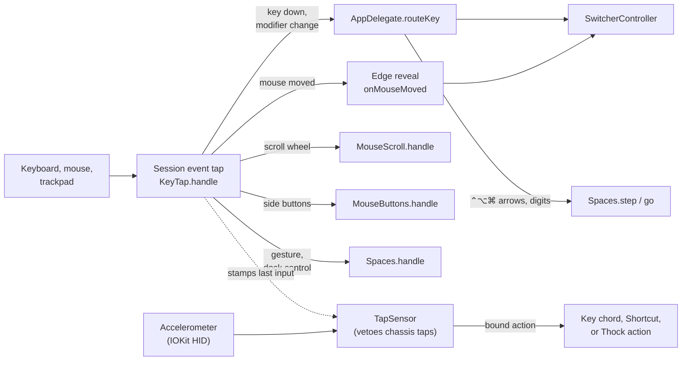
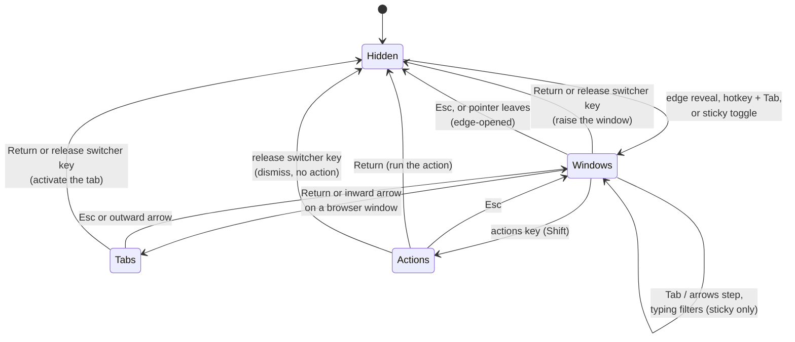
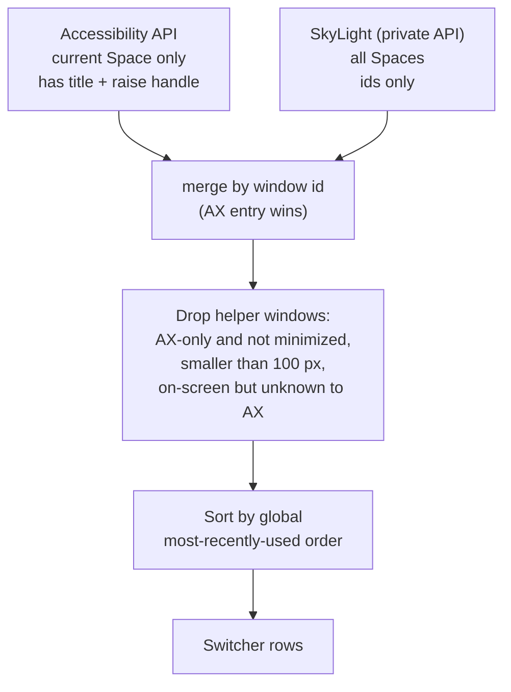
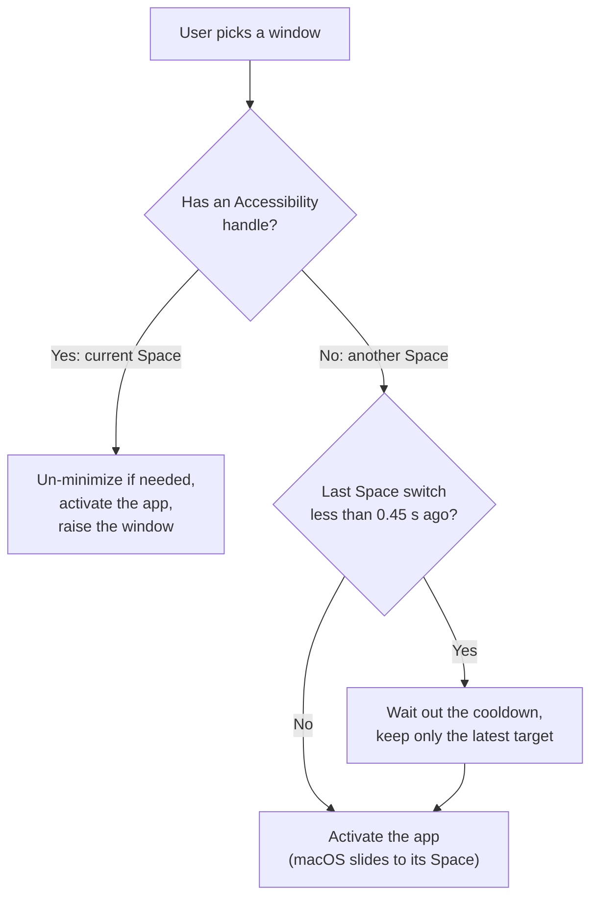
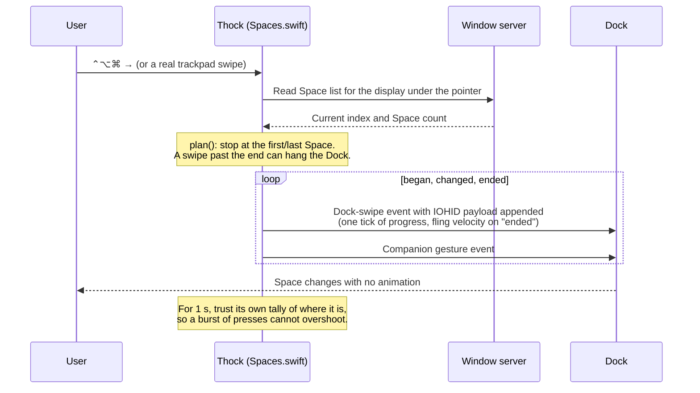
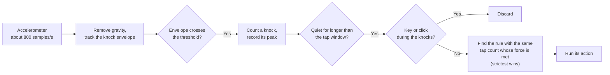
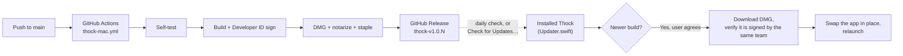

# Thock for macOS (`projects/mac-tools`)

Thock is a macOS menu-bar app written in Swift (AppKit + SwiftUI). Its main job is a window
switcher that extrudes from a screen edge. It also carries a set of small system tweaks that share
the same input pipeline: mouse scrolling and pointer control, side buttons, chassis taps, instant
Space switching and keep-awake.

- Source: [`projects/mac-tools/thock/`](../projects/mac-tools/thock) (flat Swift files, no packages)
- Requires macOS 27. It runs as a menu-bar agent with no Dock icon.
- Developer notes: [`projects/mac-tools/CLAUDE.md`](../projects/mac-tools/CLAUDE.md),
  [`MOUSE.md`](../projects/mac-tools/MOUSE.md), [`WINDOW_GROUPS.md`](../projects/mac-tools/WINDOW_GROUPS.md)

Back to the [project overview](../README.md).

## Contents

- [How input reaches each feature](#how-input-reaches-each-feature)
- [Window switcher](#window-switcher)
- [Window list and raising](#window-list-and-raising)
- [Browser tabs](#browser-tabs)
- [App actions](#app-actions)
- [Window groups](#window-groups)
- [Search and app launch](#search-and-app-launch)
- [Instant Spaces](#instant-spaces)
- [Mouse: scrolling, pointer, side buttons](#mouse-scrolling-pointer-side-buttons)
- [Chassis taps](#chassis-taps)
- [Keep awake](#keep-awake)
- [Settings](#settings)
- [Permissions](#permissions)
- [Build, test, release, update](#build-test-release-update)
- [File map](#file-map)

## How input reaches each feature

One CGEvent session tap (`KeyTap` in `ThockApp.swift`) is the only source of keyboard, mouse and
trackpad-gesture events. Each feature owns one branch of it and returns either the event (pass it
on) or nothing (swallow it). Settings are read from `UserDefaults` on every event, so a change in
the settings window applies immediately.

The tap needs the Accessibility permission. Without it, only the mouse-only switcher
(menu bar → Settings → Permissions → *Show switcher*) works.

## Window switcher

Nothing is on screen until the switcher is summoned. It then extrudes from the left or right screen
edge as a rounded "blob" with a spring animation, and collapses when done. There are three ways to
open it.

| Way | How | Behaviour |
|-----|-----|-----------|
| Edge reveal | Push the pointer into the chosen edge, in a band around the middle of the screen | A fast flick (peak speed ≥ 2200 px/s) opens at once. A slow approach waits for the hover delay (default 150 ms). It closes when the pointer leaves. |
| Hold hotkey | Hold the switcher key (⌥ by default) and tap Tab | Each Tab steps to the next window. Releasing the switcher key switches. |
| Sticky toggle | Switcher key + `` ` `` | Opens a switcher that stays open. Arrows move, Return picks, Esc or the toggle closes it. Typing filters the list. |

Keys while the switcher is open:

| Key | Action |
|-----|--------|
| Tab / ↓ | Next row (Shift+Tab or ↑ for previous) |
| Return | Open the selected browser window's tabs, or switch to the window |
| Arrow away from the edge / toward the edge | Open / close the tab layer |
| Shift (configurable) | Open the app-actions layer |
| Esc | Close the side layer; press again to close the switcher |
| `1`–`0`, `e`, `q`, `=`, `-` | Window groups (hold-hotkey switcher only) |

The switcher is a small state machine with three layers. The side card is shared by the tabs layer
and the actions layer.

Releasing the switcher key in the actions layer only dismisses, so a careless release can never
quit an app.

Each row shows a small live preview and the window title. Without the Screen Recording permission
the row shows the app icon, and windows on other Spaces show the app name in place of the title.

## Window list and raising

The list covers every Space, including minimized windows. It is built from two sources and merged
by window id, then ordered most-recently-used first.

The two sources check each other. The Accessibility API returns helper windows that are not real
(for example Chromium's status bubble), and SkyLight returns windows that an app keeps hidden (Arc
keeps one per tab). A window must look real to both sides to be listed.

Raising a window depends on where it is:

The cooldown exists because macOS drops a second activation that arrives during its own Space
slide animation.

## Browser tabs

On a Safari or Chromium-family window (Chrome, Chromium, Edge, Brave, Vivaldi, Arc, Helium, Opera), Return or the
inward arrow peels the window's tabs out as a second layer. Tab and the arrows step through them,
and Return or releasing the switcher key activates the tab. Each tab row shows the site's favicon.

Tabs are read and activated with AppleScript, so macOS asks once per browser for the Automation
permission. Until it is granted the tab layer stays empty. The key that opens tabs (Return or Space)
is set under Settings → Keybinds.

## App actions

Press the actions key (Shift by default, or Control) while the switcher is open to show a short menu
for the selected app:

- **Hide** or **Show**
- **Show in Finder**
- **Quit**

The actions run directly through `NSRunningApplication` and `NSWorkspace`. The real Dock menu is
never opened, so nothing flashes on screen. App-supplied Dock items such as *Recent Documents* are
not shown for the same reason.

## Window groups

Windows can be assigned to up to ten groups. A group's members are pinned to the top of the
switcher. Groups work in the hold-hotkey switcher only.

| Key (switcher key held) | Action |
|-----|--------|
| `1`–`9`, `0` | Make group 1–10 active and pin its members to the top |
| `e` / `q` | Next / previous group (wraps) |
| `=` | Add the highlighted window to the active group |
| `-` | Remove the highlighted window from the active group |

The switcher always shows every window. After any group key is pressed, the active group's members
move to the top with an accent dot, a divider separates them from the rest, and a `GROUP N` label
appears. Groups are saved by window id, so they last across a Thock relaunch for as long as the
windows stay open. Details: [`WINDOW_GROUPS.md`](../projects/mac-tools/WINDOW_GROUPS.md).

## Search and app launch

In the sticky switcher, typing filters the list. Each word must match the app name or the window
title, without regard to case. Backspace deletes.

While a query is active, up to five matching apps from the standard application folders appear
under a `LAUNCH` divider. Return opens the selected app, or activates it if it is already running.
The hold-hotkey switcher never searches, so plain ⌥Tab stays a pure switcher.

## Instant Spaces

Settings → Spaces switches Spaces with no slide animation and no system changes. Both options are
off by default.

| Option | Effect |
|--------|--------|
| Instant switch keys | ⌃⌥⌘ ← / → moves one Space. ⌃⌥⌘ 1–0 jumps to Space 1–10. |
| Instant swipes | The three- or four-finger trackpad swipe between Spaces becomes instant. |

The technique is a Swift port of [InstantSpaceSwitcher](https://github.com/jurplel/InstantSpaceSwitcher)
(MIT). Thock never asks the system to change Space. It posts a synthetic trackpad swipe with almost
no travel and a very high fling velocity, so the Dock commits the switch with nothing to animate.

With *Instant swipes* on, the session tap swallows the real swipe and fires one instant switch in
its place. A swipe that begins while App Exposé is showing is left alone. The switch applies to the
display under the pointer, and full-screen apps count as Spaces.

## Mouse: scrolling, pointer, side buttons

These follow the approach of BetterMouse, Scroll Reverser, Mos and LinearMouse. The research and
the exact mechanisms are in [`MOUSE.md`](../projects/mac-tools/MOUSE.md).

| Setting (pane) | Default | What it does |
|----------------|---------|--------------|
| Invert mouse scrolling (Scrolling) | On | Reverses wheel-mouse scrolling only. A wheel mouse is told apart from a trackpad by its stepped scroll events. |
| Invert trackpad scrolling (Scrolling) | Off | Reverses trackpad and Magic Mouse scrolling. |
| Smooth scrolling (Scrolling) | On, 250 ms (100–500) | Replaces each wheel notch with an eased glide of pixel-scroll events. |
| Disable acceleration (Mouse) | On | Makes pointer movement linear for external mice. |
| Sensitivity (Mouse) | 5 of 20 | Pointer speed for external mice. |
| Button 4 / Button 5 (Mouse) | Back / Forward | Each can be Off, Back or Forward. |

Notes:

- Pointer settings are written to the mouse's HID service and are put back when Thock quits. They
  are re-applied when a mouse is plugged in. The built-in trackpad is skipped.
- Chromium browsers handle side buttons themselves, so Thock passes the click through. In Safari,
  Finder, Firefox, Opera and ForkLift the click becomes a swipe-to-navigate gesture, which needs
  *Swipe between pages* turned on in System Settings.

## Chassis taps

On an Apple-silicon MacBook, knocking on the palm rest can run an action. Thock reads the built-in
accelerometer (no extra permission) and counts knocks.

Each rule is *N taps at a minimum force → action*. An action can be:

- a recorded key chord,
- a Shortcuts.app shortcut, or
- a Thock action: toggle the switcher, toggle keep awake, open settings.

Settings → Taps holds the on/off switch (off by default), the time allowed between taps (350 ms by
default, 100–1000) and the list of rules. Typing or clicking during the knocks cancels them, because
those also shake the chassis. Desktop Macs have no accelerometer, so the feature does nothing there.

## Keep awake

The menu-bar menu has a **Keep Awake** toggle that stops the display and the Mac from sleeping, like
`caffeinate -d`. It is not remembered across launches on purpose, and macOS drops it when Thock quits.

## Settings

The settings window (menu bar → **Settings…**, or ⌘,) is a dark sidebar window.

| Section | Contents |
|---------|----------|
| General | Reveal edge (left or right), hover delay (0–500 ms), window previews on/off |
| Keybinds | Switcher key (⌘, ⌥ or ⌃), tabs key (Return or Space), actions key (Shift or Control) |
| Scrolling | Scroll direction per device type, smooth scrolling |
| Mouse | Pointer acceleration and sensitivity, side buttons |
| Taps | Chassis-tap switch, tap timing, rules |
| Spaces | Instant switch keys, instant swipes |
| Permissions | Status and grant buttons for Accessibility and Screen Recording, plus *Show switcher* |
| About | Version |

## Permissions

| Permission | Needed for | Without it |
|------------|-----------|------------|
| Accessibility (required) | The event tap (hotkeys, edge reveal, mouse and Space features) and raising windows | Only the mouse-only switcher works |
| Screen Recording (optional) | Window previews, and titles of windows on other Spaces | Rows show the app icon and app name |
| Automation (optional, per browser) | Browser tabs | The tab layer stays empty |

App Sandbox is off on purpose, because a cross-app switcher cannot run sandboxed.

## Build, test, release, update

- **Run:** open `projects/mac-tools/thock.xcodeproj` in Xcode. Turn on automatic signing with a
  team once, or macOS forgets the Accessibility grant on every build.
- **Self-test:** the sources compile without Xcode. `swiftc thock/*.swift -o /tmp/thock-bin` then
  `/tmp/thock-bin selftest` runs assertions over the pure logic (window merging, MRU order, edge
  velocity, tab parsing, tap detection, Space planning and more). Everything that touches the
  system must be checked by running the app.
- **Local build to share:** `./build.sh` makes an ad-hoc signed `dist/thock.zip`.

Every push to `main` that touches `projects/mac-tools/` runs the release workflow. Installed copies
update themselves from the resulting GitHub Release.

Development builds from Xcode or `swiftc` never update themselves.

## File map

| File | Holds |
|------|-------|
| `ThockApp.swift` | App entry, menu-bar menu, the session event tap, key routing, edge reveal, the self-test |
| `Switcher.swift` | The floating panel, the SwiftUI blob, the layer state machine, search, window groups |
| `WindowManager.swift` | Window enumeration (Accessibility + SkyLight), merging, MRU order, raising |
| `BrowserTabs.swift` | Tab listing and activation through AppleScript, favicons |
| `DockMenu.swift` | The app-actions menu |
| `AppLaunch.swift` | App catalogue and search for the launch rows |
| `Thumbnailer.swift` | Window previews through ScreenCaptureKit |
| `Spaces.swift` | Instant Space switching, its keys, swipe override and settings pane |
| `MouseScroll.swift` | Scroll inversion and smooth scrolling |
| `MousePointer.swift` | Pointer acceleration and sensitivity |
| `MouseButtons.swift` | Side buttons |
| `Taps.swift` | Chassis taps: sensor, knock detector, rules, settings pane |
| `KeepAwake.swift` | Keep-awake assertion |
| `Updater.swift` | Self-update from GitHub Releases |
| `Prefs.swift` | Settings storage (`UserDefaults`) |
| `SettingsView.swift` | Settings window and shared controls |
