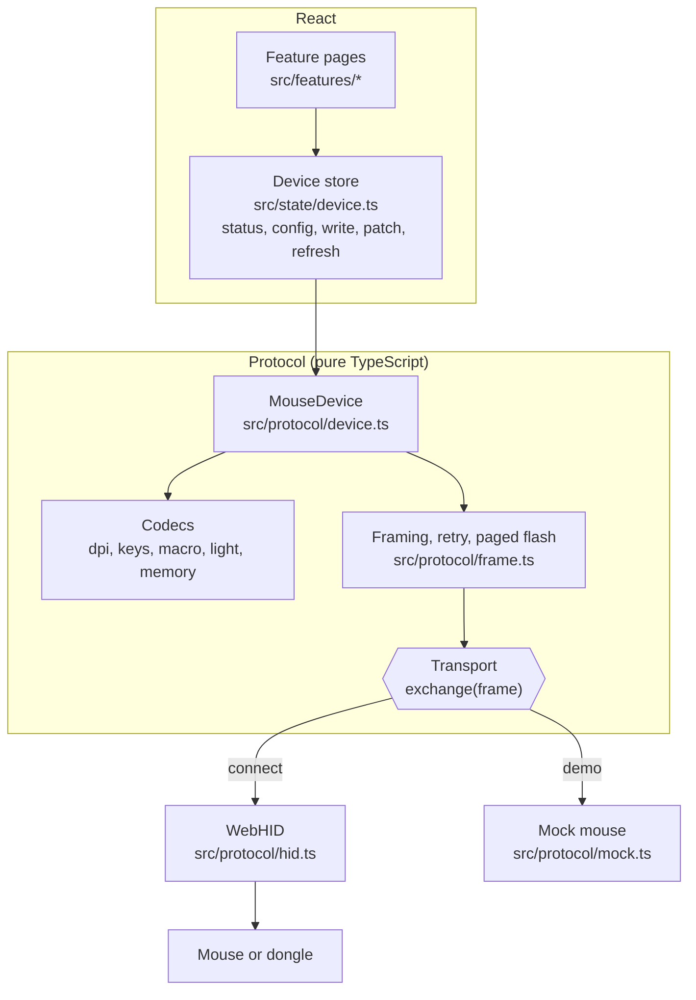
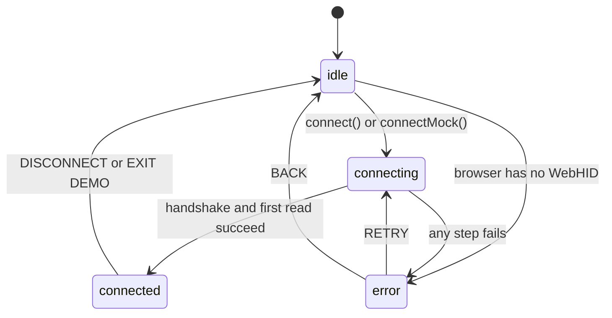
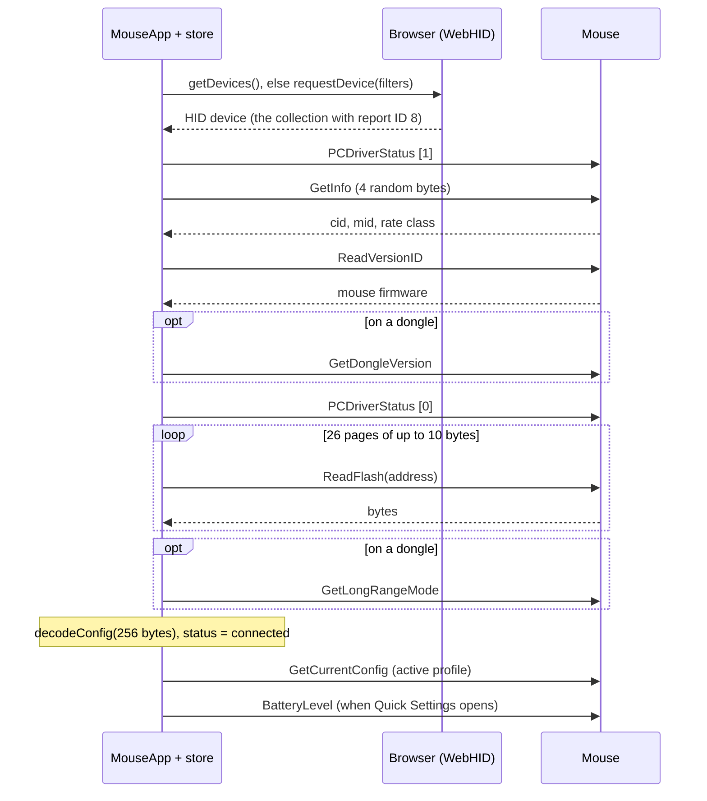
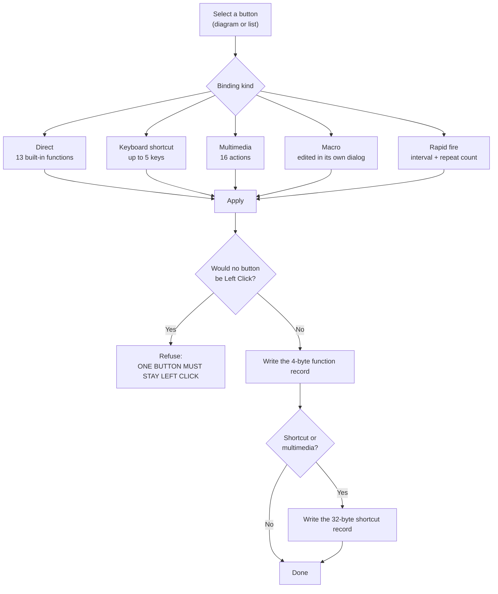
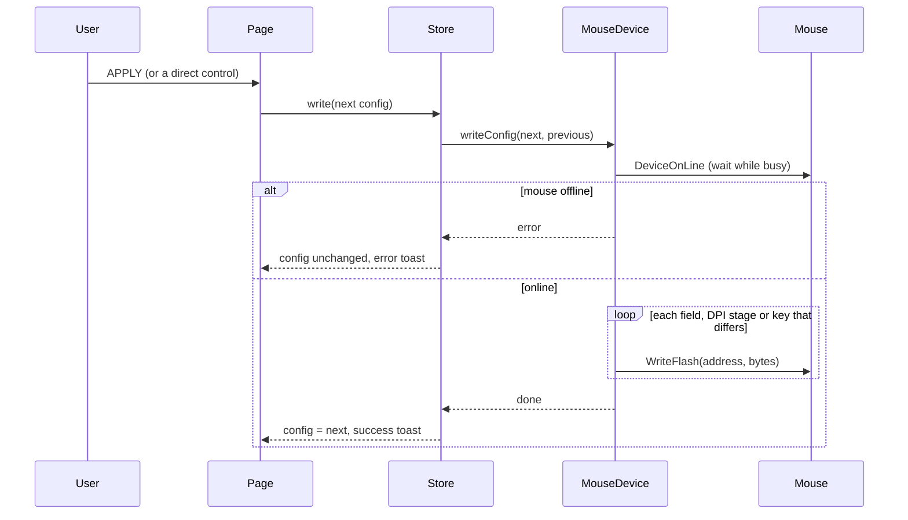
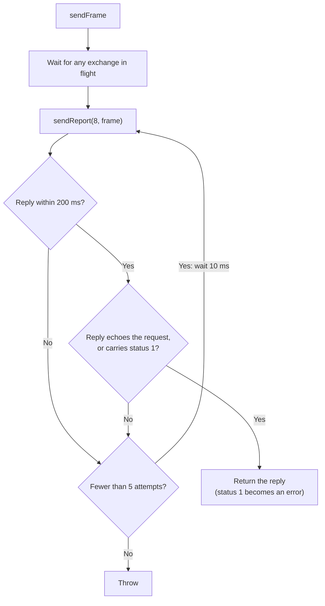

# thock/mouse (`projects/mouse`, `@thock/mouse`)

thock/mouse is a browser configurator for the Pulsar X2 CrazyLight Mini. It talks to the mouse
over WebHID, so nothing is installed and nothing leaves the machine. It covers DPI stages, polling
rate, sensor options, button bindings, macros, lighting, power settings and the four onboard
profiles.

- Source: [`projects/mouse/src/`](../projects/mouse/src)
- Protocol reference: [`projects/mouse/PROTOCOL.md`](../projects/mouse/PROTOCOL.md)
- Mounted by the [landing page](web.md); built on the [shared design system](ui.md)
- Browsers: Chrome or Edge on macOS or Windows. Firefox and Safari have no WebHID.

Back to the [project overview](../README.md).

> **Not yet checked on hardware.** The app was built against a reverse-engineered protocol and a
> software mock. Ranges, units and defaults marked ⚠ in `PROTOCOL.md` are not confirmed on a real
> mouse. The app's Help page says the same.

## Contents

- [Running it](#running-it)
- [Architecture](#architecture)
- [Connecting](#connecting)
- [Pages](#pages)
- [How settings are written](#how-settings-are-written)
- [Protocol](#protocol)
- [Safety rules](#safety-rules)
- [Known limits](#known-limits)
- [Tests](#tests)
- [File map](#file-map)

## Running it

```bash
pnpm dev:mouse     # from the repository root: opens the demo mouse at /?mock=mouse
pnpm dev           # then pick UNIT 02 and press CONNECT for a real mouse
```

From `projects/mouse`: `pnpm test` (vitest) and `pnpm typecheck`.

Demo mode uses a simulated mouse: an X2 CrazyLight Mini on a dongle, 8000 Hz capable, firmware
`v3.05`, battery 87 %. It starts from the default configuration every time, and its four profiles
share one memory image.

## Architecture

The package exports one component, `MouseApp({ mode, onExit })`. Everything below the pages is
plain TypeScript with no React in it.



The real transport and the mock implement the same `Transport` interface, so demo mode runs the
same device code, codecs and pages as a real mouse.

## Connecting

The store has four states.



While the state is `idle` or `connecting` the app shows the "Searching" screen. In `error` it shows
"No link" with the error text, RETRY and BACK.

The handshake identifies the mouse, then reads its whole configuration block in one pass.



The reply to GetInfo also says how the mouse is attached. Rate classes 2 and 3 mean wired; every
other class means a dongle. The class sets the highest polling rate the app offers (1000, 2000,
4000 or 8000 Hz). Shortcut and macro records are not read at connect. The Buttons page reads them
when needed.

## Pages

The top bar has three tabs: MOUSE, SETTINGS and HELP. It also shows the model name, firmware
versions, and profile chips `1`–`4`.

| # | Page | What it controls | Writes |
|---|------|------------------|--------|
| 1 | Quick Settings | Battery and connection, live DPI stage, polling rate, lift-off distance, motion sync, debounce | Immediately |
| 2 | My Profiles | The four onboard profiles; restore a profile to defaults | Immediately |
| 3 | DPI | Stage count, per-stage DPI and colour, the DPI indicator light | Apply / Revert |
| 4 | Polling Rate | Report rate | Immediately |
| 5 | Sensor | Tracking options, rotation calibration, performance boost, sensor mode | Apply / Revert |
| 6 | Buttons | What each of the six buttons does; macros | Apply (no Revert) |
| 7 | Lighting | The main RGB effect | Apply / Revert |
| — | Settings → General | Sleep timer, power save, debounce, long-distance mode | Immediately |
| — | Help | Notes on browser support and the unverified protocol | — |

### Quick Settings

One page with the controls used most often. Each control writes as soon as it is used.

- **Battery and connection:** a six-segment battery meter (red at 20 % or less, with a charging
  marker), connection type, mouse firmware and dongle firmware.
- **DPI stage:** one tile per active stage. Clicking a tile makes that stage live.
- **Polling:** the rates the current link supports.
- **Sensor:** lift-off distance (1 mm or 2 mm) and motion sync.
- **Debounce:** 0–15 ms.

### My Profiles

Four profile tiles. Clicking one switches the mouse to that profile and reads its configuration
again. The profile chips in the top bar do the same.

**Restore defaults** resets the active profile after a confirmation dialog. It writes the default
configuration through the ordinary setters. It is not the mouse's factory-reset command, and it
leaves shortcut and macro records alone.

### DPI

| Setting | Range | Default |
|---------|-------|---------|
| Stage count | 1–8 | 6 |
| DPI per stage | 10–32000 | 400, 800, 1600, 3200, 6400, 12800 |
| X-Y split | Off (Y follows X) or a separate Y value | Off |
| Stage colour | Any RGB colour | One per stage |
| Live stage | Any active stage | Stage 2 (800) |
| Indicator light mode | Off, Steady, Breathing | Off |
| Indicator brightness | 1–10 | 3 |
| Indicator speed (Breathing only) | 0–9 | 5 |

The slider snaps to values the sensor can store: steps of 10 below 10050, 50 up to 30100, and 100
above. The page shows exactly what the mouse will keep.

### Polling Rate

Tiles for 125, 250, 500, 1000, 2000, 4000 and 8000 Hz, limited to what the current link supports.
The default is 1000 Hz.

### Sensor

| Card | Setting | Options | Default |
|------|---------|---------|---------|
| Tracking | Lift-off distance | 1 mm, 2 mm | 1 mm |
| Tracking | Motion sync | On / off | Off |
| Tracking | Ripple control | On / off | Off |
| Tracking | Angle snapping | On / off | Off |
| Rotation calibration | Angle tune | −30° to 30° | 0° |
| Performance boost | Enable, and a duration from 10 s to 30 min | — | Off, 1 min |
| Sensor mode | Low power, High performance | — | Low power |

### Buttons

The mouse has six buttons: Left, Right, Wheel, Back, Forward and DPI. Select one on the diagram or
in the list, choose what it does, then press Apply.



- **Direct functions:** Left Click, Right Click, Wheel Click, Forward, Back, DPI Switch (Cycle, Up,
  Down), Scroll Up, Scroll Down, Polling Rate, Profile, Disable.
- **Multimedia:** media player, play/pause, next, previous, stop, mute, volume up and down, email,
  calculator, my computer, homepage, search, stop page, refresh page, favourites.
- **Rapid fire:** an interval of 10–255 and a repeat count (while held, or 1, 2 or 3 times).
- **Macros:** each button has its own macro slot. The macro dialog reads the slot from the mouse,
  lets you name it (30 characters), record key presses, add mouse events, set each event to full
  press, down or up with a delay, reorder and delete events (70 at most), then **Save macro**.

### Lighting

Modes: Off, Rainbow, Single Color Breath, Fixed Color, Neon, Rainbow Breath, Fixed Rainbow. The
page also has colour, brightness (1–10), speed (0–9) and a *Lights off while moving* switch.
Controls that a mode does not use are disabled.

### Settings → General

| Setting | Options | Default |
|---------|---------|---------|
| Sleep timer | 10 s, 30 s, 1 min, 2 min, 5 min, 10 min, 30 min | 1 min |
| Power save | Off, or a battery threshold of 5–50 % | Off (20 % when turned on) |
| Debounce | 0–15 ms | 2 ms |
| Long-distance mode (dongle only) | On / off | Off |

## How settings are written

Three pages (DPI, Sensor, Lighting) keep a draft and send it only on **Apply**, using the shared
[draft cycle](ui.md#the-draft-cycle). Enter triggers Apply. The other pages write as soon as a
control is used. Every write comes from a user action; the app never writes on load or on a timer.

A write sends only what changed.



If a write fails, the stored configuration is not updated, so the page never shows a value the
mouse does not hold. A change to one switch costs two frames: the online check and one write.

## Protocol

Every message is a 16-byte HID report with report ID 8, in both directions.

| Byte | Generic command | Flash read or write |
|------|-----------------|---------------------|
| 0 | Opcode | 7 (write) or 8 (read) |
| 1 | 0 (in replies: status, 0 = ok, 1 = rejected) | same |
| 2–3 | 0 | Address, big-endian |
| 4 | Payload length | Data length, at most 10 |
| 5–14 | Payload | Data |
| 15 | Checksum | Checksum |

The same checksum rule (`0x55` minus the byte sum) closes every stored record. Small values are
stored as a pair: the value, then `0x55 − value`.

Each exchange is retried, and a late reply is never mistaken for the answer to a newer request.



The mouse's settings live in flash memory, which the app reads and writes in pages.

| Address | Size | Holds |
|---------|------|-------|
| 0–255 | 256 bytes | The configuration block: polling rate, DPI stages and colours, indicator light, key functions, main light, debounce, sensor options, sleep and power save |
| 256 + 32 × button | 32 bytes each | Shortcut records (key combo or media key) |
| 768 + 384 × button | 384 bytes each | Macro records (name and up to 70 events) |

Profile, long-distance mode, battery, firmware versions and identity are not in the memory map.
They have their own opcodes. The full reference, with every opcode and field, is
[`PROTOCOL.md`](../projects/mouse/PROTOCOL.md).

## Safety rules

- **Commands that are never sent:** factory reset, dongle pairing, USB update mode and the whole
  firmware-update path. No code builds these frames.
- **Writes are gated.** Before a write the app checks that the mouse is online and not busy.
- **A rejected command is an error,** not data.
- **A failed write leaves the shown configuration unchanged.**
- **Guards in the page:** one button must stay Left Click, shortcuts hold at most 5 keys, and
  unknown values read from the mouse fall back to safe defaults.

## Known limits

- The app does not detect an unplugged mouse. Disconnect and connect again.
- The battery level is read once, when Quick Settings opens.
- A draft that is not applied is lost without a prompt when you open another page.
- The `Q` and `E` key hints on the tabs are shown but not yet bound.
- In demo mode, switching profiles does not change the settings.

## Tests

`pnpm test` runs 8 vitest files that cover the protocol only: frame checksums and retries, the DPI
and polling-rate codecs, key functions and shortcuts, the light and angle codecs, the macro record,
the memory map, and a full round trip through the mock (identity, read, diffed writes, shortcuts,
macros, restore). There are no tests for the React pages or the WebHID transport.

## File map

| Path (under `projects/mouse/src`) | Holds |
|------|-------|
| `index.tsx` | `MouseApp`: shell, tabs, page list, profile switching, the Enter key |
| `state/device.ts`, `state/nav.ts` | Connection and configuration store; page navigation |
| `protocol/types.ts` | The shared contract: `Transport`, `MouseDevice`, `MouseConfig`, limits |
| `protocol/frame.ts` | Frames, checksums, retry, the online gate, paged flash access |
| `protocol/hid.ts` | WebHID filters, interface matching, the serialized exchange |
| `protocol/device.ts` | The handshake and the `MouseDevice` implementation |
| `protocol/memory.ts` | The memory map, field table, `decodeConfig`, default configuration |
| `protocol/dpi.ts`, `keys.ts`, `macro.ts`, `light.ts` | Codecs |
| `protocol/models.ts` | Model names |
| `protocol/mock.ts` | The simulated mouse |
| `features/<page>/` | One folder per page |
| `components/mouse/` | The mouse diagram and the key-capture box |
| `lib/` | Colour and DPI helpers |
