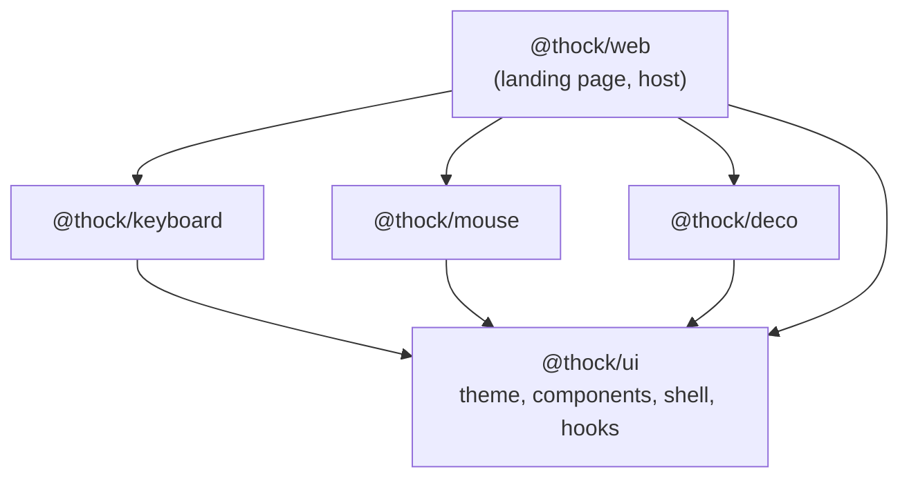
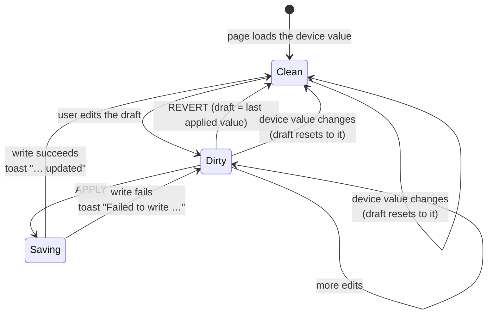

# Shared design system (`projects/ui`, `@thock/ui`)

`@thock/ui` is the design system that every web project in this repository uses: the theme, the
base components, the page "shell" (top bar, index list, status bar, cards) and a few state hooks.
It gives the keyboard, mouse and router apps one look and one way to edit and apply settings.

- Source: [`projects/ui/src/`](../projects/ui/src)
- Stack: React 19, Tailwind CSS v4, shadcn components on Base UI, lucide icons, sonner toasts
- Design specification: [`docs/marathon-redesign/`](marathon-redesign/README.md)

Back to the [project overview](../README.md).

## How it is consumed

The package has no build step. Its `package.json` exports point at the TypeScript sources, and the
host app ([`@thock/web`](web.md)) compiles them together with the device apps.

| Import path | Resolves to | Holds |
|-------------|-------------|-------|
| `@thock/ui/shell/*` | `src/shell/*.tsx` | Shell primitives |
| `@thock/ui/components/ui/*` | `src/components/ui/*.tsx` | shadcn base components |
| `@thock/ui/lib/*` | `src/lib/*.ts` | Hooks and helpers |
| `@thock/ui/assets/*` | `src/assets/*` | SVG artwork and icons |
| `@thock/ui/index.css` | `src/index.css` | Theme tokens and utilities |



## Theme

The theme is dark only. It follows the visual language of the MARATHON game site: near-black
surfaces, one acid-green accent, square corners, and small uppercase monospace labels.

| Group | Tokens | Use |
|-------|--------|-----|
| Surfaces | `void`, `panel`, `raised`, `hover` | Page background, panels, raised controls, hover state |
| Text | `ink`, `dim` | Main text, secondary text |
| Accent | `acid` | Selection, Apply, the landing page's CONNECT, the active profile chip |
| Hot hues | `orange`, `cobalt`, `red`, `magenta` (each with `-fill` and `-text`), `purple-fill` | Device posters, demo-mode marker, errors and destructive actions |
| Shape | `--radius: 0px` | Every corner is square |
| Type | Geist (text), Geist Mono (labels), Archivo at 125 % width (display) | See the utilities below |

The tokens are mapped onto the standard shadcn variable names (`background`, `primary`, `border`
and so on), so shadcn components pick up the theme without changes.

Custom utilities defined in `index.css`:

| Utility | Effect |
|---------|--------|
| `label-mono` | The small uppercase monospace label used for all interface chrome |
| `type-display` | Wide, heavy display type for large headings |
| `index-prefix` | Draws `[n]` before a label, from `data-index` |
| `bracket` | Wraps a glyph in square brackets, for example `[↗]` |
| `corner-ticks` | Small registration ticks on two corners of a panel |
| `bg-crosshair-grid` | A faint crosshair grid background |
| `value-bar` | A 3 px status strip on the top edge of a card or tile |
| `kbd-hint` | The keycap chip style |
| `bg-hazard`, `torn-edge-b` | Landing-page decoration |

Rules the theme enforces:

- **One accent, used sparingly.** Acid marks only the current selection, the Apply button, the
  landing page's CONNECT button and the active profile chip. Active tabs and index rows use a
  2 px acid bar, not a fill.
- **One focus style.** A global `:focus-visible` outline is the only ring in the system.
- **Reduced motion.** Animations stop when the user asks for reduced motion.
- **Slashed zeros** everywhere, so a `0` is never read as a letter.

## Shell primitives

Every device app is built from the same frame.

```text
┌───────────────────────────────────────────────────────────────────────┐
│ CommandBar: logo │ device status │ profile chips │ section tabs │ exit │
├──────────────┬────────────────────────────────────────────────────────┤
│ IndexList    │ PageHeader: [n] TITLE   [?]        APPLY   REVERT      │
│ [1] PAGE     │                                                        │
│ [2] PAGE     │ Stage: the device graphic on a ticked, gridded panel   │
│ [3] PAGE     │                                                        │
│              │ SettingCard   SettingCard   SettingCard                │
├──────────────┴────────────────────────────────────────────────────────┤
│ StatusBar: key hints                      ● UNSAVED   LINK: OK   v0.1 │
└───────────────────────────────────────────────────────────────────────┘
```

| Component | Role |
|-----------|------|
| `CommandBar` | The top bar: logo, device identity, profile chips `1..N` (when the device has profiles), section tabs with key hints, and DISCONNECT or EXIT DEMO |
| `IndexList` | The left page list, numbered `[n]` across groups |
| `PageHeader` | Page title with an optional help tooltip, a count such as `12/82 SELECTED`, and action buttons |
| `Stage` | The framed canvas that holds the on-screen keyboard or mouse |
| `SettingCard` | A titled card for one setting. Its top bar turns acid while the setting has unsaved changes |
| `ApplyRevert` | The APPLY and REVERT button pair. Both are disabled until something changes; APPLY shows `APPLYING…` while it saves |
| `StatusBar` | The bottom bar: key hints, an unsaved marker, link state (`LINK: OK` or `LINK: DEMO`) and the app version |
| `ConnectGate` | The "Searching" / "No link" screen shown until a device is ready, with BACK and RETRY |
| `Poster` | A device poster on the landing page with CONNECT and RUN DEMO |
| `StatChip`, `Tile` | A top-bar chip, and a square selectable tile with a value bar |

## State hooks and helpers

| Export | What it does |
|--------|--------------|
| `createNav(railOf, home, onGo?)` | Builds an app's page store. Each app calls it once with its own page list. `resetNav()` returns to the home page on disconnect. |
| `useConnectOnce(mode, connect, connectMock)` | Connects once when an app mounts: the mock device in demo mode, a real device otherwise. It guards against React StrictMode running effects twice, which would prompt for a device twice. |
| `useDraft(value, save, { noun, eq })` | The edit, Apply, Revert cycle that every settings page uses (see below). |
| `withBusy`, `withToast` | Run a device call with a busy flag or a success toast, and show a toast if it fails. |
| `diffIndices` | Lists which slots of two arrays differ. Pages use it to find changed keys or buttons. |
| `cn`, `errorMessage`, `plural` | Class merging, error text, and `"s"` for plurals. |

### The draft cycle

Pages with several related settings do not write to hardware while the user is still adjusting
them. The page keeps a *draft* copy of the device's value, and only **Apply** sends it. (Simple
one-click controls, such as a polling-rate tile, write at once and do not use a draft.)



Each app also binds the Enter key to the Apply button.

## Base components

The shadcn set, restyled for the theme: `badge`, `button`, `card`, `dialog`, `input`, `kbd`,
`label`, `popover`, `radio-group`, `scroll-area`, `select`, `separator`, `slider`, `sonner`
(toasts), `switch`, `tabs`, `toggle`, `toggle-group`, `tooltip`.

## Artwork

`src/assets/marathon/` holds the SVG set: the logo mark, the three device plates used on the
landing page, section icons and decorative marks. The design reasoning, the palette and the
per-file table are in [`docs/marathon-redesign/`](marathon-redesign/README.md).

## Commands

Run from `projects/ui`:

```bash
pnpm lint        # oxlint
pnpm typecheck   # tsc -b --noEmit
```
