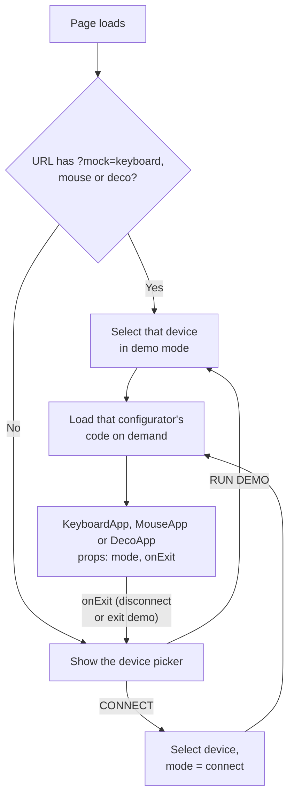
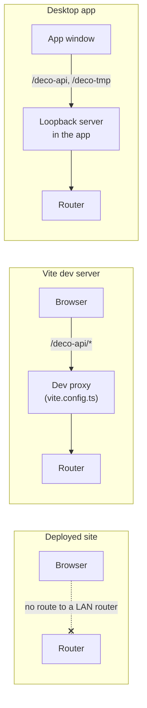

# Landing page and host app (`projects/thock`, `@thock/web`)

`@thock/web` is the web entry point. It shows a device picker with one poster per device, then
loads the chosen configurator. It is also the only web package with a real `index.html`, Vite
configuration and build: the keyboard, mouse and router packages are bundled into it from source.

- Source: [`projects/thock/`](../projects/thock)
- Stack: React 19, Vite, TypeScript, Tailwind CSS v4
- Uses: [`@thock/ui`](ui.md), [`@thock/keyboard`](keyboard.md), [`@thock/mouse`](mouse.md),
  [`@thock/deco`](deco.md)

Back to the [project overview](../README.md).

## The device picker

The landing page is one screen: a top bar, three device posters and a footer.

| Poster | Device | CONNECT is available when |
|--------|--------|---------------------------|
| UNIT 01 / KEYBOARD | Womier SK75 TMR | The browser has WebHID (Chrome or Edge) |
| UNIT 02 / MOUSE | Pulsar X2 CrazyLight Mini | The browser has WebHID (Chrome or Edge) |
| UNIT 03 / NETWORK | TP-Link Deco XE75 Pro | The page can reach the router on the LAN (see below) |

Each poster has two buttons:

- **CONNECT** opens the configurator against real hardware.
- **RUN DEMO** opens it against a simulated device. No hardware or permission is needed.

When CONNECT cannot work, the button is disabled and the poster states the reason. The **RUN DEMO**
button in the top bar opens the keyboard demo.

## From URL to configurator



Each configurator is a separate lazy-loaded chunk, because a visitor needs only one of them in a
session. All three accept the same two props: `mode` (`"connect"` or `"demo"`) and `onExit`.

## Reaching the router

The keyboard and mouse talk to hardware through WebHID, straight from the browser. The router is
different: its local API sends no CORS headers, so a browser page cannot call it directly. The
router poster's CONNECT therefore works in two places only.



| Where the page runs | Router CONNECT | How it is detected |
|---------------------|----------------|--------------------|
| Deployed static site | Disabled (demo still works) | Neither flag below is set |
| Vite dev server | Enabled | `import.meta.env.DEV` |
| [Desktop app](desktop.md) | Enabled | `window.thock.capabilities.http`, injected by the app |

The dev proxy forwards `/deco-api/*` to the router at `DECO_HOST` (default `192.168.68.1`). It also
rewrites the router's session cookie so that the browser keeps it for the dev origin. Without that
rewrite, login succeeds but the next call reads as a lost session.

## Commands

Run from the repository root:

```bash
pnpm dev             # landing page at http://localhost:5173 (use Chrome or Edge)
pnpm dev:keyboard    # opens /?mock=keyboard
pnpm dev:mouse       # opens /?mock=mouse
pnpm dev:deco        # opens /?mock=deco
DECO_HOST=10.0.0.1 pnpm dev   # point the router proxy at another address
pnpm build           # type-check and build to projects/thock/dist
pnpm preview         # build, then serve with wrangler
pnpm release         # build, then deploy with wrangler
```

## Deployment

The build is a static single-page app. `wrangler.jsonc` at the repository root serves
`projects/thock/dist` through Cloudflare Workers static assets, with every unknown path falling
back to the app. There is no server code. In the Cloudflare Workers Builds dashboard, use root
directory `/`, build command `pnpm build` and deploy command `npx wrangler deploy`.

## File map

| File | Holds |
|------|-------|
| `index.html` | The page shell |
| `src/main.tsx` | Mounts the app and the toast container |
| `src/App.tsx` | The device picker, mode selection and lazy loading of the three configurators |
| `src/index.css` | Imports the shared theme and tells Tailwind which packages to scan |
| `vite.config.ts` | Vite plugins and the `/deco-api` dev proxy |
